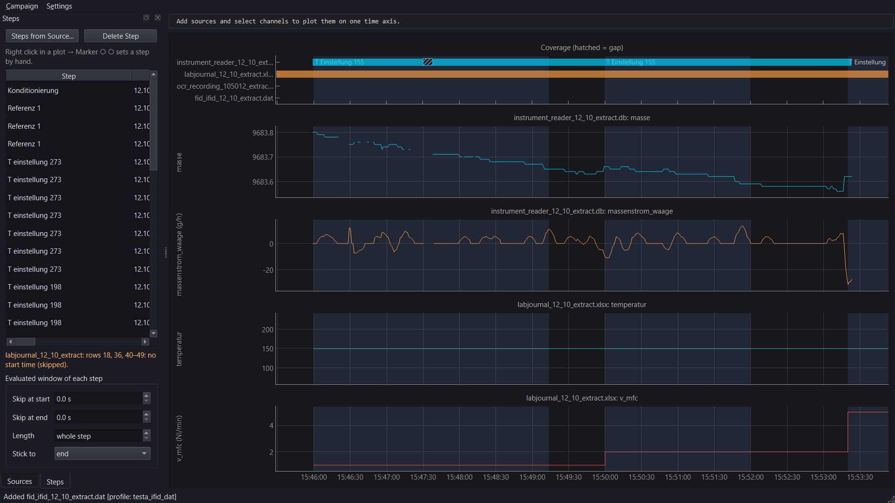
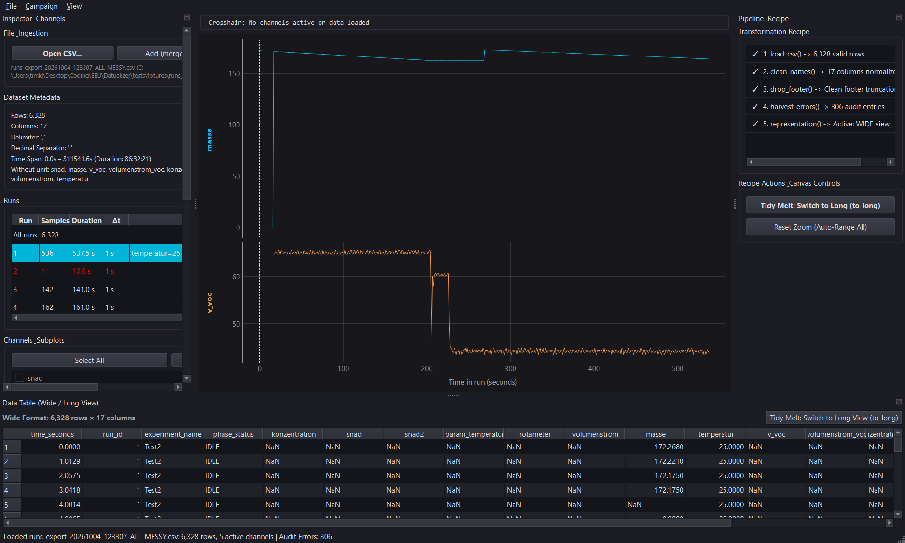
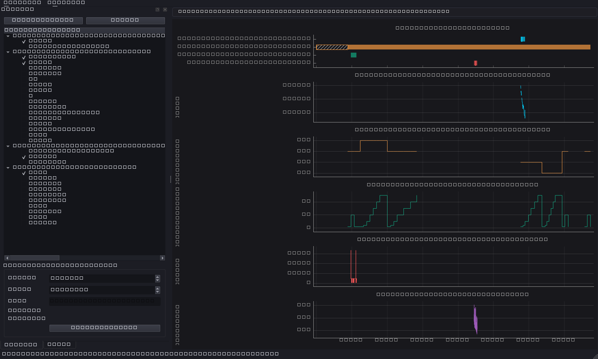
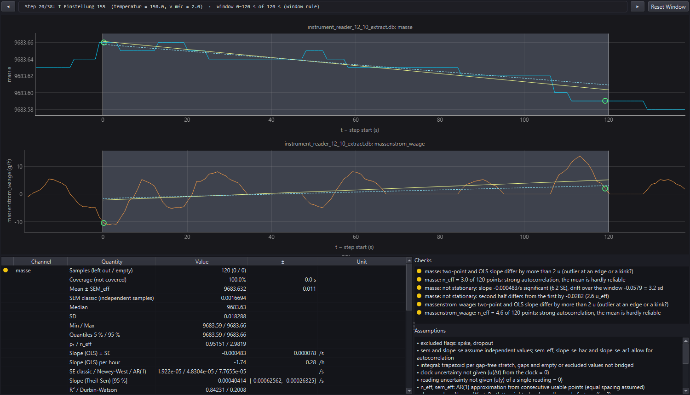
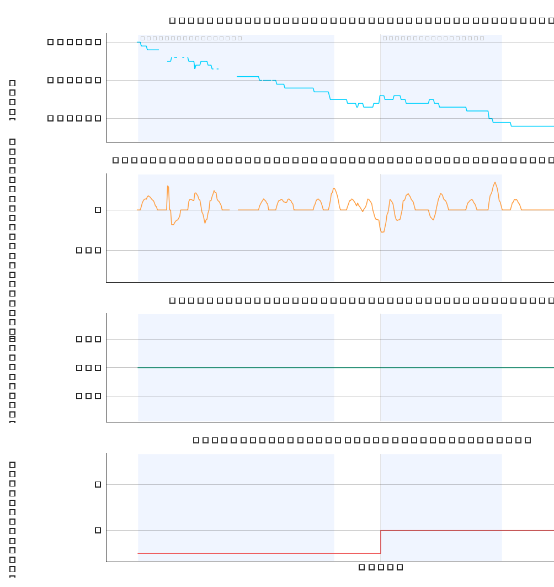
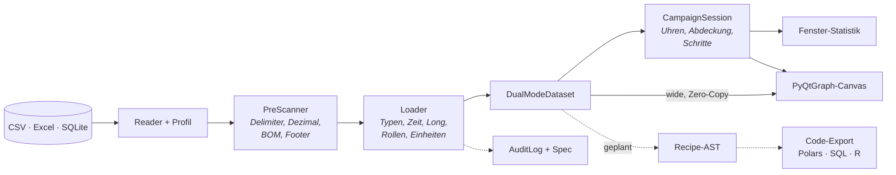

<div align="center">

# Datualizer

**Tidy Data Wrangling & Visualisierung für Mess- und Sensordaten, die sich nicht an Konventionen halten.**

*Weil `messung_final_v3_WIRKLICH_final.csv` kein Datenformat ist.*


[](https://github.com/SeTi100/Datualizer/actions/workflows/pytest.yml)



<sub>Eine echte Messkampagne: OCR-Waage (SQLite) und Labjournal (Excel) auf einer Zeitachse, Messschritte aus dem Journal als Bänder, oben die Abdeckung jeder Quelle.</sub>

</div>

---

## Worum geht's?

Jeder, der schon mal an einem Prüfstand stand, kennt das: Der Datenlogger exportiert *irgendwas*. Mal mit Semikolon, mal mit deutschem Dezimalkomma, mal mit einem Footer voller Statistiken. Der FID hat seine eigene Uhr, die Waage schreibt in eine SQLite-Datenbank, die Sollwerte stehen im Labjournal in Excel. Die übliche Antwort darauf sind 400 Zeilen Einweg-Pandas-Skript pro Gerät, die nach dem nächsten Firmware-Update keiner mehr versteht.

**Datualizer** will das ändern:

1. **Robuste Ingestion:** Chaotische Exporte (CSV, Excel, SQLite) werden erkannt, eingelesen und *ehrlich* auditiert. Kaputte Werte werden protokolliert statt still verschluckt.
2. **Mehrere Geräte, eine Zeitachse:** Jede Quelle behält ihre Daten, nur die Uhr wird korrigiert (Versatz, Drift, Ankerpunkte). Messschritte kommen aus dem Labjournal.
3. **Auswertung mit ehrlicher Unsicherheit:** Mittelwert, Steigung und Integral pro Messschritt, mit Autokorrelation, robuster Steigung und einer Ampel, die sagt, wann einem Wert nicht zu trauen ist.
4. **Schnelle Visualisierung:** Native Desktop-Plots mit PyQtGraph, verlinkten Zeitachsen und Fadenkreuz, ohne Browser dazwischen.

Kurz gesagt: **PowerQuery-Ergonomie für Ingenieursdaten**, mit der Reproduzierbarkeit, die eine wissenschaftliche Auswertung braucht.

> [!NOTE]
> Datualizer ist ein Studierendenprojekt im frühen Stadium (Etappe 2 von 7). Einlesen, Messkampagnen und Fenster-Statistik laufen und sind getestet, Rezepte und Code-Export sind noch Plan. Wer Feedback, Testdaten oder Meinungen hat: [Issue aufmachen](https://github.com/SeTi100/Datualizer/issues), ausdrücklich erwünscht.

---

## Ein Rundgang

Alle Bilder stammen aus der App selbst, gerendert aus den Testdaten im Repo ([`tools/readme_screenshots.py`](tools/readme_screenshots.py)).

### 1. Einen chaotischen Export laden und verstehen



Ein Pipeline-Export mit allem, was schiefgehen kann: abgebrochene Runs, Sensor-Dropouts, Leerfelder, 306 unlesbare Zellen. Datualizer erkennt Trennzeichen, Dezimalkomma und Zeitspalte selbst. Links steht, was die Automatik entschieden hat, die Runs mit Dauer und Sollwerten (der abgebrochene Mini-Run ist rot), rechts die Schritte bis zur Tabelle, unten die Daten. Ein Klick auf einen Run plottet nur diesen, mit Zeit ab Run-Start. Jede Entscheidung lässt sich über eine `IngestionConfig` überschreiben, und die ausgeschriebene Spec lädt dieselbe Tabelle beim nächsten Mal wieder exakt gleich.

### 2. Mehrere Geräte auf eine Zeitachse legen



Eine Messkampagne mit vier Quellen in vier Formaten: Waage per OCR in SQLite, Labjournal in Excel, OCR eines Videos als CSV, FID als Text-Export. Geräteprofile wissen, wie jedes Gerät exportiert; fehlt etwas (Blatt, Datum zu reinen Uhrzeiten), fragt die App nach. Pro Quelle korrigiert ein Uhrenmodell Versatz und Drift. Die Abdeckungsspur oben zeigt auf einen Blick, wann welches Gerät Daten hat, Lücken sind schraffiert. Gespeichert wird alles als `campaign.json`, mit relativen Pfaden und Hash pro Datei.

### 3. Messschritte aus dem Labjournal

Im Bild ganz oben sind die Schritte aus dem Labjournal als Bänder über allen Plots eingeblendet, links steht die Liste mit Problemen (Journalzeilen ohne Startzeit) und der Regel, welcher Teil jedes Schritts ausgewertet wird (z. B. „die letzten 2 Minuten“). Welche Spalten Start, Ende, Name und Sollwerte sind, kommt aus dem Profil oder wird aus der Datenform erraten, nie aus dem Code. Eigene Schritte setzt man per Rechtsklick → *Marker ○ ○*.

### 4. Jeden Schritt ehrlich auswerten



Der Fenster-Inspektor zeigt einen Schritt im Detail: das ausgewertete Fenster, die OLS-Gerade (durchgezogen), die robuste Theil-Sen-Gerade (gestrichelt) und die Stützstellen der 2-Punkt-Differenz. Darunter die Kennwerte mit Unsicherheit. Weil dicht abgetastete Sensoren stark autokorreliert sind, gibt es neben dem klassischen SEM auch `n_eff`, `SEM_eff` und Newey-West-Fehler. Die Ampel rechts sagt in Klartext, was auffällt: hier ein signifikanter Drift und nur 3 effektiv unabhängige Punkte von 120. Die Fensterränder lassen sich ziehen, Bild ab/auf springt zum nächsten Schritt.

### 5. Für den Bericht exportieren

<table>
<tr>
<td width="45%"></td>
<td>

*Campaign → Export Plot…* schreibt genau den gezeigten Ausschnitt als **PNG, SVG oder PDF**: Breite in mm (Standard: A4-Textbreite), Schrift und Linienbreite in pt, helles oder dunkles Theme. Am Bildschirm bleiben die Linien 1 px dünn und schnell, im Bericht sind sie so dick, wie sie sein sollen.

Dazu pro Kanal: Anzeigename, Stil (Linie, Punkte, Treppe), Farbe und Y-Skalierung (*auto*, *robust* gegen OCR-Ausreisser, *fest*). Werte ausserhalb des Bereichs werden am Rand markiert, nicht weggelassen.

</td>
</tr>
</table>

---

## Features

| Bereich | Was es kann |
|---|---|
| **Einlesen** | Trennzeichen, Dezimalkomma, Tausendertrenner, BOM, Footer, Sentinels (`ERR`, `-999`, `#DIV/0!` …) mit Audit; Typ-Inferenz pro Spalte; Long-Format erkennen und nach wide pivotieren |
| **Formate & Profile** | Text (`.csv`, `.dat`, `.txt`), Excel (`.xlsx`, `.xls`), SQLite; Geräteprofile als JSON (Testa iFID, PicoLog, instrument_reader, Labjournal) |
| **Struktur** | Messwert vs. Parameter (Sollwerte), Runs mit abgebrochenen Mini-Runs, leere Spalten, Einheiten aus dem Header |
| **Mehrere Dateien** | `load_csvs` mit Dedupe über SHA-256 und Schlüssel, Konflikte im Audit |
| **Qualität** | Flags statt Löschen: Lücke, Dropout, Sprung, eingefrorener Sensor, Bereich, Hampel-Spike |
| **Zeit** | Absolute Zeit mit Zeitzone und Sommerzeit, Startzeit für Logger mit verstrichener Zeit, Datum für reine Uhrzeiten |
| **Messkampagne** | Mehrere Quellen auf Master-Zeit, Uhrenmodell (Versatz, Drift, Anker), Abdeckung, Messschritte, `campaign.json` |
| **Formeln** | Sicherer Parser (Positivliste, kein `eval`), Polars-Ausdruck oder numpy mit linearer Fehlerfortpflanzung: Budget je Eingang, zufällig/systematisch getrennt, korrelierte Gruppen |
| **Fenster-Statistik** | Mittelwert, Median, SD, SEM, OLS- und Theil-Sen-Steigung, 2-Punkt-Differenz nach GUM, Integral; AR(1)-`n_eff`, Newey-West, Durbin-Watson, Stationaritäts-Ampel |
| **Plots** | Eigenes Peak-Downsampling ohne Linien über Lücken, verlinkte Zeitachsen, Fadenkreuz-Werte, Subplots nach Kanal/Einheit/Quelle, Export PNG/SVG/PDF |

Alles mit Code-Beispielen: **[ausführliche Anleitung](docs/BENUTZUNG.md)**.

**Geplant:** Pydantic-Recipe-AST mit Undo/Redo und Replay · `join_asof` für asynchrone Sensoren · Rechengrössen für Kampagnen · Video-Spur · visueller Recipe-Editor · Code-Export (Polars / DuckDB-SQL / R Tidyverse) · portable Windows-`.exe`. Details in der [Roadmap](#roadmap).

---

## Schnellstart

### Installation

Voraussetzung: **Python ≥ 3.11**

```bash
git clone https://github.com/SeTi100/Datualizer.git
cd Datualizer
```

Mit [uv](https://docs.astral.sh/uv/) (empfohlen):

```bash
uv venv
uv pip install -e ".[dev]"
```

Oder klassisch mit pip:

```bash
python -m venv .venv
.venv\Scripts\activate
python -m pip install -e ".[dev]"
```

Unter Linux und macOS heißt der zweite Schritt `source .venv/bin/activate`.

Danach die Umgebung in jedem neuen Terminal aktivieren (`.venv\Scripts\activate`), bevor du die App oder die Tests startest. Pakete nachinstallieren oder nach einem `git pull` die Abhängigkeiten aktualisieren immer mit demselben Befehl wie oben (`uv pip install -e ".[dev]"` bzw. `python -m pip install -e ".[dev]"`).

> **Nicht einfach `pip install` tippen.** Ein mit uv angelegtes `.venv` enthält kein pip. `pip` startet dann das pip einer anderen Python-Installation und installiert dorthin, auch wenn das `.venv` aktiv ist. Die App findet die Pakete anschließend nicht (`ModuleNotFoundError`). `python -m pip` bzw. `uv pip` installiert immer in die gerade aktive Umgebung.

### GUI starten

```bash
python -m datualizer_gui.app
```

Ohne aktivierte Umgebung geht es mit `uv run python -m datualizer_gui.app` oder `.venv\Scripts\python.exe -m datualizer_gui.app`.

Liegt `SA_testmessung_1.csv` im Arbeitsverzeichnis, wird sie automatisch geladen. Alles andere geht über *File → Open CSV…* (`Ctrl+O`, öffnet auch Excel und SQLite). Die Kampagnenansicht öffnet *Campaign → Open Campaign Window…* (`Ctrl+K`). Zum Ausprobieren eignen sich die Dateien in [`tests/fixtures/sa_12_10/`](tests/fixtures/sa_12_10/).

### Als Bibliothek nutzen

```python
from datualizer_core import load_csv

ds = load_csv("SA_testmessung_1.csv")      # PreScan + Laden + Audit in einem Rutsch
ds.channels                                # Messkanäle (ohne Parameter und Metadaten)
ds.ingestion_spec                          # was die Automatik entschieden hat, replaybar
ds.audit_log.to_dataframe()                # welche Zelle war kaputt, und warum?
```

```python
from datualizer_core.campaign import CampaignSession, ClockModel

s = CampaignSession()
fid = s.add_source("data-10-32-50.dat")                 # Profil testa_ifid_dat erkannt
waage = s.add_source("instrument_reader.db")
journal = s.add_source("labjournal.xlsx")
s.set_clock(fid.id, ClockModel(offset_s=970, note="FID-Uhr 16:10 hinter PC"))
s.set_mapping(s.suggest_mapping(journal.id))            # Messschritte aus dem Labjournal
s.window_table([(waage.id, "masse")])                   # Kennwerte pro Schritt
s.save("campaign.json")
```

### Formeln

Rechengrössen sind Formeln als Text, geprüft gegen eine Positivliste (Zahlen, Namen, `+ − * / **`, Vergleiche, `and/or/not`, `a if c else b`, `log`, `exp`, `sqrt`, `min`, `max`, `where` …), nie mit `eval`. Dieselbe Formel rechnet als Polars-Ausdruck auf Rohdaten oder mit numpy samt linearer Fehlerfortpflanzung (Dual-Zahlen): Ergebnis, u gesamt, zufällig, systematisch und der Beitrag jedes Eingangs.

```python
from datualizer_core.calc import Constant, UArray, compile_expr

X = compile_expr("1 - (S - B) * f / c_in", names=["S", "B", "f", "c_in"]).evaluate({
    "S": UArray.input("S", 25.807, 0.10),                          # FID-Endwert, zufällig
    "B": UArray.input("B", 2.266, 1.0),                            # Blindwert, zufällig
    "f": Constant(name="f", value=2.701, u=0.135, kind="syst"),    # Umrechnung, systematisch
    "c_in": 144.361,
})
X.value, X.u(), X.u_random(), X.u_syst()   # 0.560, 0.029, 0.019, 0.022
X.budget()                                  # {'S': -0.0019, 'B': 0.0187, 'f': -0.0220}
```

Mehr dazu in der [ausführlichen Anleitung](docs/BENUTZUNG.md).

### Tests

```bash
python -m pytest -q
```

---

## Architektur



### Leitprinzipien

- **Robustness First:** Echte Messdaten sind keine sauberen Rechtecke. Die Ingestion muss mit dem Schlimmsten rechnen und darf trotzdem nicht abstürzen.
- **Automatik schlägt vor, der Nutzer entscheidet:** Jede Heuristik ist überschreibbar, jede Entscheidung steht ausgeschrieben in der Spec.
- **Nichts wird destruktiv verändert:** Keine In-place-Mutationen. Qualitätsprobleme werden markiert, nicht gelöscht.
- **Ehrliches Audit:** Ein Wert, der nicht geparst werden kann, wird *protokolliert* und nicht still zu `NaN` gemacht.

---

## Projektstruktur

```
Datualizer/
├── datualizer_core/            # Engine, ohne GUI-Abhängigkeiten
│   ├── dataset.py              # DualModeDataset, AuditLog
│   ├── quality.py              # Qualitäts-Flags (Lücken, Dropout, Sprünge, Spikes, …)
│   ├── timebase.py             # absolute Zeit, Zeitzonen, Sommerzeit
│   ├── campaign/               # Messkampagne: Quellen, Uhren, Abdeckung, Schritte, Darstellung
│   ├── stats/window.py         # Fenster-Statistik eines Messschritts
│   ├── ingestion/              # PreScanner, Typ-Inferenz, Loader, Reader, Profile, Merge
│   ├── pipeline/operators.py   # clean_names, drop_footer, unpivot
│   └── profiles/*.json         # Geräteprofile (Daten, kein Code)
├── datualizer_gui/             # PySide6-Desktop-App (Einstieg: app.py)
│   ├── main_window.py          # Hauptfenster: eine Datei oder mehrere zusammengeführt
│   ├── campaign_window.py      # Kampagnenfenster
│   └── components/             # Plots, Docks, Dialoge, Export
├── tools/readme_screenshots.py # rendert die Bilder in docs/img/
├── tests/fixtures/             # echte Exporte als Testkorpus (unveränderlich)
└── docs/                       # Anleitung, Masterplan, Datenkataloge, Recherche
```

---

## Roadmap

| Etappe | Thema | Status |
|:---:|---|:---:|
| 1 | Minimal End-to-End Tracer Bullet | ✅ |
| 2 | Ingestion-Festung für chaotische Realdaten | 🔜 grösstenteils fertig |
| 2b | Messkampagne: mehrere Geräte, Uhren, Schritte, Fenster-Statistik, Rechengrössen | 🔜 Schritte 1–7 fertig, Schritt 8 begonnen |
| 3 | Tidy- & Reshaping-DSL (JSON-AST, 10 Operatoren, `join_asof`) | ⏳ |
| 4 | Tidy-Axiom-Validierung & KI-gestützte Recipe-Reparatur | ⏳ |
| 5 | High-Performance-Visualisierung (LTTB, Multi-Y, ROI) | ⏳ |
| 6 | Desktop-UX & Multi-Target-Code-Export | ⏳ |
| 7 | Beta-Härtung & Standalone-Windows-Binary | ⏳ |

Details: [`docs/MASTER_ETAPPEN_PLAN.md`](docs/MASTER_ETAPPEN_PLAN.md).

---

## Testdaten

Datualizer wird gegen echte Exporte entwickelt, nicht gegen Lehrbuch-CSVs:

- [`tests/fixtures/runs_export/`](tests/fixtures/runs_export/): Pipeline-Exporte mit abgebrochenen Runs, Duplikaten, Dateinamen, die über ihr eigenes Format lügen, Sensor-Dropouts als `0.0` und Parametern namens `snad2` ([Datenkatalog](docs/DATENKATALOG_RUNS_EXPORT.md)).
- [`tests/fixtures/sa_12_10/`](tests/fixtures/sa_12_10/): Ausschnitte einer echten Mehrgeräte-Kampagne mit FID, Thermoelement-Logger, OCR-Waage und Labjournal, jedes Gerät mit eigener Uhr und eigenem Format ([Datenkatalog](docs/DATENKATALOG_SA_KAMPAGNE.md)).

**Du hast besonders hässliche Messdaten?** Her damit (gern anonymisiert). Jede neue Pathologie macht Datualizer robuster.

---

## Mitmachen

Issues, Bug-Reports und Pull Requests sind willkommen. KI-Agenten (und gern auch Menschen) lesen vorher [`AGENTS.md`](AGENTS.md): Dort stehen Ziel, Prinzipien, Arbeitsablauf und die nächsten offenen Punkte. Ein paar Hausregeln:

- `python -m pytest` muss grün sein, bevor etwas gemergt wird.
- Neue Ingestion-Features bekommen eine Fixture mit dem Problemfall dazu.
- Keine In-place-Mutationen von DataFrames (siehe Leitprinzipien).
- Ändert sich die GUI sichtbar, die Bilder mit `python tools/readme_screenshots.py` neu rendern.

---

## Lizenz

Noch nicht festgelegt. Bis dahin gilt: alle Rechte vorbehalten. Wer den Code nutzen möchte, fragt kurz nach.

---

<div align="center">
<sub>Gebaut mit Polars, Qt und einer gesunden Abneigung gegen Excel-Exporte.</sub>
</div>
