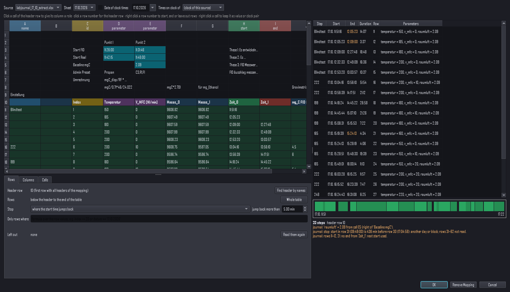
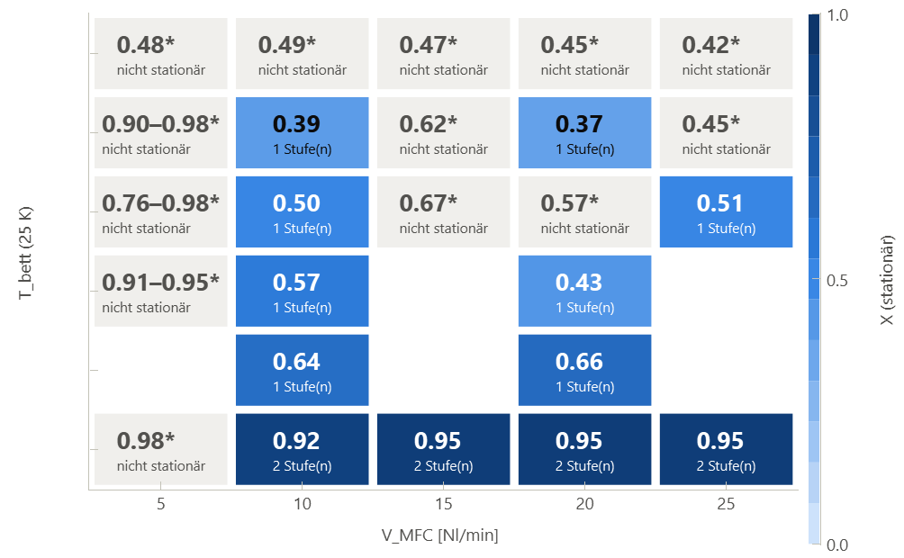
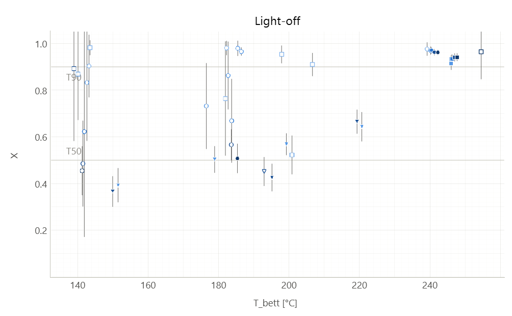

# Datualizer benutzen: ausführliche Anleitung

Diese Seite sammelt die Details zur Bibliothek und zur GUI, die früher alle im README standen. Den Überblick mit Bildern gibt das [README](../README.md).

## Als Bibliothek nutzen

```python
from datualizer_core import load_csv

ds = load_csv("SA_testmessung_1.csv")      # PreScan + Laden + Audit in einem Rutsch

ds.shape                                   # (4931, 9)
ds.columns                                 # ['time_seconds', 'kanal_1', 'kanal_2', ...]

t = ds.to_numpy("time_seconds", allow_copy=False)   # Zero-Copy-View für Plots
long = ds.to_long()                                  # [time_seconds, channel, value]

if ds.audit_log.has_errors():
    print(ds.audit_log.to_dataframe())     # Welche Zelle war kaputt, und warum?
```

## Automatik schlägt vor, du entscheidest

Jede Heuristik (Zeitspalte, Spaltentypen, Long-Format, Messwert vs. Parameter, Namens-Vokabulare, Schwellen) ist über eine `IngestionConfig` überschreibbar. Und jedes geladene Dataset verrät, was die Automatik entschieden hat:

```python
from datualizer_core import ColumnKind, IngestionConfig, LongFormatConfig, load_csv

ds = load_csv("export.csv")
spec = ds.ingestion_spec                     # alle Entscheidungen, ausgeschrieben
print(spec.model_dump_json(indent=2))        # → speichern, prüfen, korrigieren …

cfg = IngestionConfig(
    column_kinds={"Versuch": ColumnKind.IDENTIFIER,           # Spaltentyp erzwingen
                  "Temperatur": ColumnKind.NUMERIC},          # konstanter Sensor bleibt Messkanal
    long_format=LongFormatConfig(variable_col="Groesse",      # Long-Rollen selbst festlegen
                                 value_col="Betrag",
                                 channel_attr_cols=["Masseinheit"]),
)
ds = load_csv("export.csv", config=cfg)      # … und reproduzierbar neu laden
```

**Messwert oder Parameter?** Eine numerische Spalte, die in jedem Run konstant ist (Sollwerte wie `Rotameter` oder `target_temperature`), wird als `ColumnKind.PARAMETER` eingestuft. Sie bleibt in `ds.df`, steht in `ds.parameters` und wird nicht als Kanal geplottet (`ds.channels`). Runs erkennt der Loader an Spalten wie `run_id` (`Vocabulary.run_tokens`), oder du gibst sie vor: `IngestionConfig(roles=RoleConfig(run_columns=["Charge"]))`. Ein Sensor, der zufällig konstant misst, sieht genauso aus wie ein Sollwert. Den stufst du per `column_kinds` zurück auf `NUMERIC`.

## Was der Loader erkennt

**Leere Spalten** werden markiert, nicht gelöscht: `ds.fill_ratio` liefert den Füllgrad pro Spalte, `ds.empty_columns` die Spalten ohne jeden Wert. Der Inspector zeigt leere Kanäle grau und abgewählt an.

**Runs** sind eine eigene Dimension: `ds.runs` zeigt pro Run Samples, Dauer, Median-Δt, Parameterwerte und ein `aborted`-Flag für Mini-Runs (Schwelle über `IngestionConfig(runs=RunConfig(aborted_fraction=0.1))`). `ds.channel_availability` liefert den Füllgrad je Run und Kanal, `ds.select_run((2,))` ein neues Dataset nur mit Run 2 und run-relativer Zeit. In der GUI plottet ein Klick in die Run-Tabelle nur diesen Run.

**Mehrere Dateien zusammenführen:** `load_csvs([alt, neu])` lädt mehrere Exporte als ein Dataset. Byte-identische Dateien erkennt der Loader am SHA-256 und lädt sie nur einmal (Audit: `duplicate_file`). Überlappende Snapshots werden über den Schlüssel dedupliziert (Zeit, bei Long-Tabellen Zeit und Variable): Die später angegebene Datei gewinnt, abweichende Werte der früheren Datei stehen als `merge_conflict` im Audit. Mit `IngestionConfig(merge=MergeConfig(conflict=MergeConflictMode.ERROR))` schlägt jeder Konflikt laut fehl, `MergeConfig(key_columns=[...])` setzt den Schlüssel selbst. `ds.sources` zeigt pro Datei Hash, übernommene, ersetzte und widersprüchliche Zeilen. Wide und Long oder verschiedene Dezimaltrenner werden nicht gemischt (`MergeError`). In der GUI: Mehrfachauswahl unter *Open CSV…* oder *File → Add CSV (merge)…*.

**Qualitäts-Flags** markieren verdächtige Samples, ohne die Daten anzufassen: `ds.quality_flags` ist eine Ereignistabelle (`row`, `channel`, `flag`) mit `gap` (Session-Lücke), `missing` bzw. `missing_calculated` (Leerfeld in einem Kanal, der im Run sonst Werte hat; Rechenkanäle getrennt), `stuck` (eingefrorener Sensor), `jump` (z. B. Nachfüllen), `dropout` (kurzer Ausreißer, der aufs alte Niveau zurückkehrt, z. B. Waage meldet 0.0), `out_of_range` und `spike` (Hampel-Ausreißer in beide Richtungen, z. B. OCR liest 9628 statt 9672,8 g). Dazu gibt es `ds.quality_summary`, `ds.flag_mask(["dropout"], channel="masse")` und `ds.with_flag_columns()` (neue Tabelle mit einer Flag-Spalte pro Kanal). Schwellen stehen in `IngestionConfig(quality=QualityConfig(...))`; Sprungschwellen werden pro Kanal aus den Daten vorgeschlagen und landen ausgeschrieben in der Spec. Plausible Bereiche kennt nur der Nutzer: `QualityConfig(ranges={"Massenstrom Waage (g/s)": (0.0, None)})`. Der `spike`-Detektor vergleicht jeden Wert mit dem Median eines zentrierten Zeitfensters (`spike_window_s`, ohne Vorgabe 21 typische Abtastschritte) und markiert ihn, wenn er mehr als `spike_k` · 1,4826 · MAD (Start k = 3) davon abweicht; `spike_channels` schränkt die Kanäle ein, `spike_window_s=0` schaltet ab. Als Untergrenze der Streuung dient `spike_min_scale` (ohne Vorgabe die kleinste Stufe zwischen den Werten, also die Auflösung, z. B. 0,01 g), sonst würde bei quantisierten Werten schon eine Ziffer zum Spike. Mit Untergrenze 0 bleiben Fenster mit MAD = 0 unbeurteilt und stehen in `ds.quality_notes` (`spike_mad_zero`). Der Plot verbindet keine Linien über Lücken, der Inspector zählt die Flags pro Kanal.

**Einheiten** gehen nicht verloren: `Massenstrom Waage (g/s)` wird zur Spalte `massenstrom_waage`, und `ds.units["massenstrom_waage"]` ist `"g/s"`. Bei Long-Exporten kommt die Einheit aus der Einheiten-Spalte. `ds.unitless_columns` zeigt Kanäle und Parameter ohne Einheit. Eigene Einheiten oder andere Schreibweisen im Header: `IngestionConfig(units=UnitConfig(units={"snad2": "°C"}, header_patterns=[r"/\s*(?P<unit>\S+)\s*$"]))`. Die Plot-Achsen zeigen die Einheit an.

**Andere Formate und Geräteprofile:** `load_source(pfad)` lädt Text (`.csv`, `.tsv`, `.txt`, `.dat`), Excel (`.xlsx`, `.xls`) und SQLite-Datenbanken (`.db`). Ein Profil beschreibt pro Gerät Reader, Optionen und `IngestionConfig` als JSON (`datualizer_core/profiles/`). `detect_profile` wählt es anhand von Dateimuster und Hinweisen (Kopfzeile, Blatt- oder Tabellennamen). Mitgeliefert sind Profile für Testa iFID (`.dat`, `.xls`), PicoLog-CSV, instrument_reader (`.db` und OCR-CSV) und ein Labjournal. Ohne passendes Profil verhält sich `load_source` wie `load_csv`. Was der Reader zusätzlich findet, steht in `ds.source_meta`: Excel-Nebenblätter mit Geräteeinstellungen und Kalibrierung, gelöschte IDs in der Datenbank, die Annahme hinter einer berechneten Startzeit. Eigene Profile: `load_source(pfad, load_profile("mein_geraet.json"))`. Hat eine Excel-Datei mehrere Blätter oder eine Datenbank ohne Profil mehrere Tabellen, nennt der `ReaderError` die Auswahl maschinenlesbar (`exc.choice` = `"excel.sheet"` bzw. `"sqlite.table"`, `exc.options`). `with_choices(pfad, profil, sheet=…, table=…, clock_date=…)` legt die Wahl in einer Profilkopie ab, `needs_clock_date(ds)` sagt, ob reine Uhrzeiten noch ein Datum brauchen, `date_in_text("12.10.2026")` liefert einen Datumsvorschlag aus Blatt- oder Dateinamen. In der GUI öffnet *Open…* alle diese Formate und fragt bei Bedarf nach Blatt bzw. Tabelle und dem Datum für Uhrzeiten.

## Messkampagne: mehrere Geräte auf einer Zeitachse

**Messkampagne: mehrere Geräte auf einer Zeitachse.** `CampaignSession` lädt mehrere Quellen (jede mit ihrem Profil) und legt sie auf eine gemeinsame Master-Zeit in der Zone der Kampagne. Pro Quelle korrigiert ein `ClockModel` die Geräteuhr: Versatz (`offset_s`), Drift (`drift_ppm`) oder stückweise linear über Ankerpunkte (`ClockAnchor`, z. B. eine im Video abgelesene Uhrzeit), mit Methode, Unsicherheit und Notiz zur Annahme. `session.track(quelle, kanal)` liefert einen Kanal auf Master-Zeit. Die Kampagne wird als `campaign.json` gespeichert, mit relativen Pfaden, Profil, aufgelöster Spec und Hash pro Datei; beim Öffnen werden geänderte oder fehlende Dateien gemeldet (`session.warnings`).

```python
from datualizer_core.campaign import CampaignSession, ClockModel
s = CampaignSession()
fid = s.add_source("data-10-32-50.dat")                 # Profil testa_ifid_dat erkannt
pico = s.add_source("SA_Messung_Picolog.csv")           # Start aus Speicherzeit (Annahme)
s.set_clock(fid.id, ClockModel(offset_s=970, method="cross_correlation", note="FID-Uhr 16:10 hinter PC"))
cov = s.coverage(pico.id)                                # wann die Quelle Werte hat, wo Lücken sind
[(g.reason, g.duration_s) for g in cov.gaps]             # Logger-Aussetzer als "no_values"
s.save("campaign.json")
```

**Uhren abgleichen** (Etappe 2b, Schritt 7). Zwei Wege, beide schlagen nur vor; `set_clock` wendet an, das `ClockModel` nennt Methode, Unsicherheit und Annahme.

*Uhrenpaare aus einer Arbeitsmappe:* Steht im Labjournal dasselbe Ereignis auf beiden Uhren („Start FID“ auf der FID-Uhr, „Start Real“ auf der PC-Uhr), beschreibt `ClockCells`, in welchen Zellen. Welche Zellen das sind, ist Konfiguration, nicht Code: als Adresse (`source_cell="D3"`) oder robuster über die Beschriftung daneben (`source_label="Start FID", master_label="Start Real", nth=1` für den ersten Wert rechts davon, `nth=2` für den zweiten; leere Zellen werden übersprungen). So überstehen die Paare eingefügte Spalten (im Journal vom 17.10. wanderten sie mit der neuen Spalte „Index“ von C3/D3 nach D3/E3). Der Vorschlag ist der Median der Paar-Versätze, die Unsicherheit die mittlere absolute Abweichung (mindestens der halbe Ablese-Schritt). Die Konfiguration bleibt im Modell und steht in `campaign.json`.

```python
from datetime import date
from datualizer_core.campaign import CellPair, ClockCells
journal = s.add_source("SA_Labjournal.xlsx", source_id="journal")
cells = ClockCells(source_id="journal", sheet="17.10.2026", day=date(2026, 10, 17), pairs=[
    CellPair(source_cell="C3", master_cell="C4", note="Punkt 1"),
    CellPair(source_cell="D3", master_cell="D4", note="Punkt 2"),
])
model, anchors = s.clock_from_cells(cells)   # offset_s = 974.5, uncertainty_s = 0.5, method "journal_pairs"
s.set_clock(fid.id, model)
```

*Kreuzkorrelation:* `s.cross_correlate((ref_quelle, kanal), (quelle, kanal), start, ende, lag_min, lag_max, derivative=False)` legt beide Spuren im Ausschnitt [start, ende] (Master-Epoch-Sekunden) auf ein gemeinsames Raster und rechnet für jeden Versatz im Suchbereich Pearsons r über die Punkte, die beide haben. Lücken werden nie überbrückt. Das Ergebnis (`XCorrResult`) enthält den besten Versatz `lag_s`, die Kurve `lags_s`/`r_curve`, `r`, die Überlappung und `checks` mit Ampel (`level`): Spitze am Rand des Suchbereichs, schwache Ähnlichkeit, zweite fast gleich hohe Spitze. `derivative=True` vergleicht die Ableitungen (unterschiedliche Nullpunkte und langsame Drift stören dann nicht). Der Versatz gilt relativ zur aktuellen Uhr der Quelle:

```python
res = s.cross_correlate(("pico", "K1"), (fid.id, "tempcat"), t0, t1, -1800, 1800, derivative=True)
s.set_clock(fid.id, s.campaign.source(fid.id).clock.shifted(res.lag_s, method="cross_correlation",
            uncertainty_s=res.uncertainty_s, note=res.summary()))
```

In der GUI öffnet *Align Clock…* (Knopf unter dem Uhren-Editor oder Rechtsklick auf eine Quelle) den Dialog für die gewählte Quelle. Reiter *Cross-correlation*: Referenzspur einer anderen Quelle und ein Kanal dieser Quelle, normiert überlagert (nur Anzeige); der helle Bereich ist der verglichene Ausschnitt (ziehbar, zu Beginn der sichtbare Zeitbereich), der Schieber verschiebt die Quelle von Hand, *Correlate* sucht im Suchbereich und zeigt die Kurve r(Versatz) mit dem besten Versatz und den Befunden. Reiter *Journal pairs*: Arbeitsmappe der Kampagne, Blatt, Datum (Vorschlag aus dem Blattnamen), Ablese-Schritt und die Zellpaare; *Read Pairs* listet die Anker mit ihren Versätzen. *Apply* schreibt das Modell des offenen Reiters mit Methode und Notiz (`cross_correlation`, `journal_pairs` oder, nach Verschieben von Hand, `manual`).

**Abdeckung:** `session.coverage(quelle)` liefert pro Quelle die Zeitspanne (`span`), die Abschnitte mit Werten (`segments`) und die Lücken (`gaps`) auf Master-Zeit. Eine Lücke ist entweder ein als `gap` markierter Zeitsprung (`time_gap`, Schwelle `QualityConfig.gap_factor`) oder eine Strecke, in der die Zeit weiterläuft, aber kein Kanal einen Wert hat (`no_values`, z. B. Logger-Aussetzer oder ungültige OCR-Lesungen), auch am Anfang oder Ende. `coverage(quelle, ["kanal"])` zählt nur die genannten Kanäle. Quellen ohne absolute Zeit haben keine Spanne. Die Daten selbst bleiben unverändert.

**Messschritte:** Welche Spalten einer Quelle (z. B. des Labjournals) Start, Ende, Name und Sollwerte eines Schritts sind, beschreibt eine `IntervalMapping` (Ende als Zeitspalte, Dauerspalte, „bis zum nächsten Start“ oder feste Länge; Blocknamen, die nur in der ersten Zeile stehen, über `fill_down`; Zeiten optional auf der Uhr einer anderen Quelle). Nichts davon steht im Code: `session.suggest_mapping(quelle)` nimmt den Vorschlag des Profils (`SourceProfile.intervals`) oder errät die Rollen aus der Datenform. `session.intervals()` liefert alle Schritte auf Master-Zeit, dazu `problems` (Zeilen ohne Start, unlesbares Ende …). Schritte von Hand: `session.add_interval(start, ende, "Blindwert")`. `WindowRule` legt fest, welcher Teil jedes Schritts ausgewertet wird (Einschwingzeit abschneiden, nur die letzten N Sekunden). Alles steht in `campaign.json`.

```python
s.set_mapping(s.suggest_mapping(journal.id))           # Vorschlag aus dem Profil labjournal_xlsx
s.set_window_rule(WindowRule(length_s=120))            # nur die letzten 2 min jedes Schritts
for step in s.intervals().intervals:
    print(step.label, step.window, step.params)
```

**Robuste Schrittzuordnung (Journal, das sich ändert):** Ein Labjournal wächst während der Messung: Spalten werden eingefügt, ein Block eines anderen Tages landet darunter, Überschriften bekommen Einheiten. Die Zuordnung hält das aus oder scheitert laut, sie liefert nie still falsche Schritte.

- *Spalten nur über die Überschrift*, nie über die Position. Gross/klein, Leerzeichen und ein Einheiten-Anhang zählen nicht (`V_MFC` findet `V_MFC [Nl/min]`, auch die bereinigte Schreibweise `v_mfc` passt). Fehlt eine Überschrift, scheitert die Zuordnung mit Vorschlag („no column 'Temperatur' (did you mean 'Temperatur_Soll'?)“). Spalten ohne Überschrift heissen wie beim Excel-Reader `col_<Buchstabe>`; nur sie hängen an der Position.
- *Kopfzeile:* die erste Zeile, die alle zugeordneten Überschriften enthält, oder fest `rows.header_row`. Zeilennummern sind Blattzeilen wie in Excel (bei CSV und SQLite ist die Kopfzeile Zeile 1); `origin` und `problems` nennen sie.
- *Zeilen* (`RowSelection` in `rows`): `first_row`/`last_row`, `stop` = `none`, `first_empty_start` oder `time_jump` (die Startzeit springt um mehr als `time_jump_min` Minuten zurück: anderer Tag oder Block darunter; Vorschlag des Profils `labjournal_xlsx`), `where` (Formel des Formelkerns über die Zeilenwerte, Namen bereinigt, Zahlen und Text, z. B. `index <= 20` oder `datum == '17.10.2026'`, dazu `row` für die Zeilennummer) und `skip_rows`. Jede ausgelassene Zeile steht mit Grund in `problems`.
- *Ende mit Rückfall:* `EndRule(column="Zeit_1", fallback=EndRule(kind="next_start"))` nimmt die Endspalte und, wo sie leer ist, den nächsten Start; das steht je Zeile in `problems` und in `step.note`.
- *Standardwerte:* `parameter_defaults={"luft": 100}` füllt einen Parameter, dessen Spalte (oder JSON-Schlüssel) fehlt oder dessen Zelle leer ist. Bezüge mit `match` scheitern dann nicht an NaN.
- *Stabile Schritt-IDs:* `id_column="Index"` gibt die ID `<quelle>:<wert>` statt der Zeile. Ohne ID-Spalte folgen von Hand gesetzte Fenster (`WindowOverride`) ihrem Schritt über Name und Start, wenn sich die Zeilen verschieben; das steht in `session.warnings`.
- *Parameter aus einer zweiten Tabelle:* `ParameterLookup` in `IntervalMapping.lookups`. Beispiel 15.10.: Die Schritte kommen aus den Runs der Datenbank, Start- und Endmasse aus dem Journal. Der Lookup liest das Journal mit eigenen Spaltenrollen (`source_id`, `sheet`, `day`, `start_column`, `end`, `parameter_columns`, `rows`) und gibt jedem Schritt die Werte `take` der unbenutzten Journalzeile, deren `match`-Parameter gleich sind und deren Start höchstens `tolerance_s` entfernt liegt (die nächste). `duration_as` speichert die Dauer der Journalzeile (für einen Massenstrom über deren Zeiten), `when` beschränkt die Schritte (`"v_mfc > 0"`), `prefix` vermeidet Namensgleichheit. Zeilen ohne Wert zählen nicht; ein Schritt ohne Zeile wird gemeldet, nichts wird geraten. Die Herkunft steht in der Notiz des Schritts („masse_0, masse_1 from journal_17:row 34 (start −34 s)“).
- *Zellwerte über ihre Beschriftung:* `CellValue(name="raumluft", label="Baseline mgC")` sucht die Zelle mit diesem Text und nimmt den ersten Wert rechts davon (`direction="below"`, `nth`, oder `cell="E5"`); der Wert hängt als Parameter an jedem Schritt der Zuordnung, aus einer anderen Quelle oder einem anderen Blatt über `source_id`/`sheet`.
- *Geänderte Datei:* Beim Speichern merkt sich die Zuordnung Kopfzeile, Spalten und Schritte (`resolved`). Beim Öffnen meldet `session.warnings`, was sich geändert hat: neue oder fehlende Spalten, Kopfzeile verschoben, mehr Zeilen, neue, entfallene oder geänderte Schritte. Passt die gespeicherte Lese-Spec nicht mehr zur geänderten Datei, wird sie mit dem Profil neu gelesen (statt abzubrechen) und das gemeldet.

```python
from datualizer_core.campaign import CellValue, IntervalMapping
from datualizer_core.ingestion.steps import EndRule, RowSelection

s.set_mapping(IntervalMapping(
    source_id="journal", start_column="Zeit_0",
    end=EndRule(column="Zeit_1", fallback=EndRule(kind="next_start")),
    label_columns=["col_A"], fill_down=["col_A"],
    parameter_columns=["Temperatur", "V_MFC", "Masse_0", "Masse_1"], parameter_defaults={"luft": 100},
    id_column="Index", rows=RowSelection(stop="time_jump"),
    cell_values=[CellValue(name="raumluft", label="Baseline mgC")],
))
d = s.derive_mapping(s.campaign.interval_mappings[0])  # Schritte plus Zustand jeder Zeile
print(d.header.row, len(d.intervals), d.problems)      # 10, 20, ['… stop: start in row 31 (09:49:00) is 436 min before row 30 …']
```

*Dialog „Steps from Source“:* zeigt das rohe Blatt als Raster (Excel-Buchstaben, Zeilennummern, auch die Zeilen über der Kopfzeile, Blattwahl). Ein Klick auf eine Zelle der Kopfzeile öffnet das Rollen-Menü (Start, Ende, Dauer, Name, Name als Block, Parameter, ID, ignorieren); zugeordnete Spalten sind farbig und tragen ihre Rolle im Spaltenkopf. Ein Klick auf eine Zeilennummer setzt die Kopfzeile, der Rechtsklick bietet „Table starts/ends here“ und „Leave out row“; Ziehen über die Zeilennummern wählt einen Bereich. Zeilen sind eingefärbt: wird Schritt (grün), ausgelassen (grau, Grund im Tooltip), Problem (orange). Unter dem Raster stehen Stop-Regel, `where`-Filter (geprüft beim Tippen), End-Rückfall und Standardwerte; im Reiter *Cells* landen Zellwerte und Uhrenpaare, die per Rechtsklick auf eine Zelle gesetzt werden (die Beschriftung links davon wird übernommen). Rechts die Vorschau als Tabelle und Zeitleiste, live aktualisiert. CSV- und SQLite-Schrittquellen erscheinen als Raster ihrer Tabelle.



**Fenster-Statistik** (Etappe 2b, Schritt 6, Paket A): `session.window_table([(quelle, kanal), …])` liefert pro Schritt × Kanal eine Zeile mit Schritt, Fenster, Sollwerten und den Kennwerten aus `datualizer_core.stats.window_stats`: Anzahl Punkte, ausgeschlossene (`StatsConfig.exclude_flags`, Standard `spike`, `dropout`, `masked`) und leere Werte, Abdeckungsgrad, Mittelwert, Median, SD, SEM, Min/Max, 5-/95-%-Quantil, OLS-Steigung pro Sekunde mit klassischem Standardfehler, R² und Residuen-SD, 2-Punkt-Differenz Δy/Δt mit Unsicherheit nach GUM (Ablesung aus `StatsConfig.reading_u`, Uhr aus `ClockModel.uncertainty_s`) und das Trapez-Integral. Lücken, leere und ausgeschlossene Werte werden nie überbrückt: Die nicht abgedeckte Zeit steht in `integral_gap_s`. `checks` nennt, was auffällt (zu wenige Punkte, geringe Abdeckung, 2-Punkt weicht von der Steigung ab), `assumptions`, worauf die Werte beruhen. SEM und klassischer Steigungs-SE setzen unabhängige Werte voraus und sind bei dicht abgetasteten Sensoren zu klein. Deshalb gibt es zusätzlich (Paket B): `rho1`, `n_eff` und `sem_eff` (AR(1)-Näherung), `slope_se_hac` (Newey-West, Lag `StatsConfig.hac_lag`, sonst ⌊4·(n/100)^(2/9)⌋), `slope_se_ar1`, `durbin_watson`, die robuste Theil-Sen-Steigung `slope_theil_sen` mit 95-%-Intervall `ts_ci_low`/`ts_ci_high` (Kendall, bei Autokorrelation verbreitert; ab 1000 Punkten aus einer festen Stichprobe von Paaren), `integral_u` und die Ampel `stationary` (Steigungstest und Hälftenvergleich `halves_diff`, Begründung in `checks`). Weichen OLS und Theil-Sen um mehr als 2 SE ab, steht das in `checks` (Ausreisser oder Knick). Die Einstellungen stehen als `stats` in `campaign.json`.

```python
from datualizer_core.stats import StatsConfig
s.set_stats_config(StatsConfig(reading_u={"instrument_reader/masse": 0.01 / 12**0.5}))  # Auflösung 0,01 g
t = s.window_table([("instrument_reader", "masse")])
t.select("step_label", "v_mfc", "n", "coverage", (t["slope"] * 3600).alias("g_h"), "slope_se", "checks")
```

**Praktische Stationarität (Äquivalenztest):** Bei 1-Hz-Daten ist fast jede Steigung signifikant, die Ampel `stationary` steht dann auf „nicht stationär“, obwohl der Drift fachlich bedeutungslos ist. Mit einer Toleranz δ pro Kanal in Einheit pro Sekunde (`StatsConfig.equivalence={"fid/conc": 0.1 / 60}` für 0,1 mgC/min) prüft ein TOST, ob das 90-%-Intervall der Steigung (Steigung ± 1,645 · größerer der beiden autokorrelationsfesten SE) ganz in ±δ liegt: `stationary_practical` ist dann `True`, die getestete Toleranz steht in `equivalence_delta`, die Begründung in `assumptions` bzw. `checks`. Ohne δ bleibt das Feld `None`. Beispiel FID-Plateau vom 12.10. (letzte 120 s): Steigung −0,051 mgC/min, statistisch signifikant (4,4 SE), praktisch stationär bei δ = 0,1 mgC/min.

Einen einzelnen Schritt liefert `s.window_stats(schritt, quelle, kanal)` als `WindowResult`. Jeder Eintrag in `checks` hat zusätzlich eine Stufe (`check.level`: `fail` bei keinen oder zu wenigen Punkten, sonst `warn`); `result.level` fasst sie zur Ampel zusammen (`ok` ohne Befund). Das Fenster eines einzelnen Schritts lässt sich von Hand setzen: `s.set_window_override(schritt_id, start, ende)` ersetzt dort die Fenster-Regel, `clear_window_override` hebt das wieder auf. Overrides stehen in `campaign.json` (`window_overrides`), in `window_table` zeigt die Spalte `window_override` sie an. Bekommt ein Journal-Schritt später einen anderen Namen oder fehlt er, steht das in `intervals().problems`.

Im Kampagnenfenster zeigt das Dock *Steps* die Schritte (Doppelklick zoomt und öffnet den Fenster-Inspektor, Rechtsklick bietet beides einzeln), die Probleme und die Fenster-Regel; *Steps from Source…* öffnet die Zuordnung am Tabellenblatt (siehe unten). Als Bänder über allen Plots erscheinen die Schritte, wenn *Settings → Tools → Interval Bands* eingeschaltet ist (Standard: aus, die Wahl wird gemerkt). Eigene Schritte: Rechtsklick → *Marker ○ ○*; der erste Klick setzt den Start (erster Kreis grün, gestrichelte Linie), der zweite das Ende. Eigene Bänder lassen sich ziehen, umbenennen und löschen; Esc verwirft einen offenen Marker.

**Schrittarten, benannte Fenster, Schritt-Tabelle** (Etappe 2b, Schritt 8, PR 3) stehen in `campaign.json` unter `evaluation`:

- `StepClass(name, when)`: Eine Schrittart ist eine Formel über die Schrittparameter, Zahlen und Text (`"v_mfc > 0"`, `"Probe == 'Eingang'"`). Bekannt sind ausserdem `step_id`, `step_label` (Text) und `dauer_s`. Es gewinnt die erste Klasse, deren Formel wahr ist. Passt keine, bleibt die Klasse leer; passen mehrere, nimmt der Datualizer die erste. In beiden Fällen steht ein Hinweis in `step_classes().notes` bzw. in der Spalte `klasse_hinweis`. Eine Formel mit unbekanntem Parameter schlägt laut fehl (`ExprError` mit Vorschlag).
- `NamedWindow(name, rule, classes=[])`: Fensterregel mit Namen, wahlweise nur für bestimmte Klassen. Die bisherige `window_rule` ist das Fenster `default`, ältere `campaign.json` lesen sich unverändert. `s.step_window(schritt, "blank")` liefert das Fenster eines Schritts, `s.window_stats(schritt, quelle, kanal, window="blank")` die Kennwerte darin. Ein Override von Hand gilt pro Fenster: `s.set_window_override(id, start, ende, window="blank")`, gespeichert unter `"<id>@blank"`.
- `Measure(alias, source, channel, window, stat)`: eine Zahl pro Schritt, `stat` ist ein Feld von `WindowResult` (`mean`, `slope`, `two_point`, `integral`, `median`, `stationary_practical` als 1/0 …). Die Standardunsicherheit kommt mit: `mean` → √(`sem_eff`² + `reading_u`²), `slope` → `slope_se_eff`, `two_point` → `two_point_u`, `integral` → `integral_u`, sonst leer.
- *Mehrere Quellen:* `Measure(alias, sources=[…], channel, …)` statt `source`, in Vorrangreihenfolge (der FID in zwei Dateien, die Waage aus Datenbank und Video, eine Quelle je Messtag). Jeder Schritt nimmt die erste Quelle mit genug Punkten im Fenster: `min_n` (Punkte) und `min_coverage` (abgedeckter Anteil des Fensters, Lücken und leere Werte zählen nicht). Welche, steht in der Spalte `<alias>_quelle`; warum eine Quelle nicht genommen wurde, in `checks_<alias>` („not taken: fid_15a: n = 12, coverage 4 % …“). Mit nur einer Quelle gelten die Schwellen genauso (zu wenig Punkte → Wert leer, mit Begründung). Quellen, die es in der Kampagne nicht gibt, werden übersprungen, solange eine andere bleibt; eine einzelne unbekannte Quelle schlägt laut fehl.

`s.step_table()` (oder `s.step_table(spec)` mit einer eigenen `Evaluation`, ohne die Kampagne zu ändern) liefert eine Zeile pro Schritt: `step_id`, `step_label`, `step_start`, `step_end`, `dauer_s`, die Parameter, `klasse`, `klasse_hinweis` und je Messgrösse `<alias>`, `u_<alias>` und `checks_<alias>`. Ein Fenster, das nicht zur Klasse des Schritts passt, lässt seine Messgrössen leer. Liefert es keine Daten, steht der Grund in `checks_<alias>`.

```python
from datualizer_core.campaign import Evaluation, Measure, NamedWindow, StepClass, WindowRule

s.set_evaluation(Evaluation(
    step_classes=[StepClass(name="null", when="v_mfc == 0"), StepClass(name="dosierung", when="v_mfc > 0")],
    windows=[NamedWindow(name="ende", rule=WindowRule(length_s=120)),
             NamedWindow(name="blank", rule=WindowRule(length_s=180), classes=["null"]),
             NamedWindow(name="masse", rule=WindowRule(skip_start_s=60))],
    measures=[Measure(alias="S", source="fid", channel="conc", window="ende", stat="mean"),
              Measure(alias="S_b", source="fid", channel="conc", window="blank", stat="mean"),
              Measure(alias="mdot", source="waage", channel="masse", window="masse", stat="slope")],
))
t = s.step_table()
t.select("step_label", "klasse", "S", "u_S", "S_b", "mdot", "u_mdot")
```

Im Dock *Steps* zeigt die Spalte *Class* die Schrittart; ein Schritt ohne oder mit mehreren Klassen ist orange, der Hinweis steht im Tooltip. Bearbeitet werden Klassen, Fenster und Messgrössen vorerst in `campaign.json`, das Dock *Results* folgt mit PR 5.

Der **Fenster-Inspektor** (Dock *Window*, auch per Rechtsklick im Plot → *Inspect step*) zeigt die gewählten Kanäle rund um einen Schritt:
- das ausgewertete Fenster hell hinterlegt,
- die OLS-Gerade (durchgezogen) und die Theil-Sen-Gerade (gestrichelt),
- ausgelassene Samples als rote Kreuze,
- die Stützstellen der 2-Punkt-Differenz als grüne Kreise.

Darunter stehen die Kennwerte mit Unsicherheit (auf zwei Stellen der Unsicherheit gerundet), die Befunde mit Ampel pro Kanal und die Annahmen. Die Fensterränder lassen sich ziehen. Das gilt nur für diesen Schritt und wird in `campaign.json` gespeichert: Die Kante wird orange, im Steps-Dock steht „window ✎“. *Reset Window* überlässt den Schritt wieder der Fenster-Regel. Bild ab / Bild auf schaltet zum nächsten bzw. vorigen Schritt. Gibt es benannte Fenster, wählt eine Auswahl neben dem Titel, welches gezeigt und gezogen wird (`default` oder z. B. `blank`). Ein Fenster, das nicht zur Klasse des Schritts passt, zeigt keine Kennwerte, sondern den Grund.

In der GUI öffnet *Campaign → Open Campaign Window…* (Ctrl+K) die Kampagnenansicht: links die Quellen mit Profil, Zeitspanne und Uhr, darunter der Uhren-Editor; rechts oben, falls unter *Settings → Tools → Coverage Info* eingeschaltet (Standard: aus, die Wahl wird gemerkt), die Abdeckungsspur (eine Zeile pro Quelle, Abschnitte mit Werten gefüllt, Lücken schraffiert, die Infozeile nennt Dauer und Art der Lücke unter dem Fadenkreuz), darunter ein Subplot pro gewähltem Kanal, jeder mit eigenem x-Array auf einer gemeinsamen Datumsachse (verlinkt, ohne Resampling). Die Ansicht zeigt immer alle Spuren; eigenes Zoomen bleibt bis *Reset Zoom* erhalten. Beim Hinzufügen fragt das Fenster nach Blatt bzw. Tabelle und, bei reinen Uhrzeiten, nach dem Datum (Vorschlag aus dem Blattnamen); die Wahl steht im Profil und in der Spec der Quelle in `campaign.json` und wird beim Öffnen ohne Rückfrage wieder angewendet.

**Darstellung pro Kanal** (nur Anzeige, die Daten bleiben unverändert): Rechtsklick oder Doppelklick auf einen Kanal im Quellen-Baum oder *Settings → Channel Display…* (Ctrl+D) öffnet die Einstellungen. Wählbar sind der Anzeigename (Alias, z. B. für Excel-Spalten `col_9`, deren Überschrift nur eine Einheit war; er erscheint in Achse, Baum und Infozeile, der Kanalname im Datensatz bleibt), der Stil (Linie, Punkte, Treppe, Linie + Punkte) und die Y-Skalierung: *Auto*, *robust* (1.–99. Perzentil, einstellbar, damit seltene OCR-Ausreisser den Rest nicht flach drücken) oder *fest* (min, max). Werte ausserhalb des Bereichs werden nicht verworfen, sondern am oberen oder unteren Rand mit einem Dreieck markiert. Der Standardstil kommt aus dem Profil (`SourceProfile.plot_style`; das Labjournal-Profil zeichnet Messschritte als Treppe). Die Einstellungen stehen pro Quelle unter `display` in `campaign.json`, nur Abweichungen vom Standard werden gespeichert:

```python
from datualizer_core.campaign import ChannelDisplay, YScale, YScaleMode
s.set_display("instrument_reader", "massenstrom_waage", ChannelDisplay(y_scale=YScale(mode=YScaleMode.ROBUST)))
s.set_display("SA_Labjournal", "col_9", ChannelDisplay(alias="Massenstrom Waage", style="line_points"))
s.track("SA_Labjournal", "col_9").name                   # "Massenstrom Waage"
```

**Zeit und Zoom im Kampagnenfenster** (Menü *Settings*): Das Mausrad zoomt standardmässig nur die Zeitachse (über einer Y-Achse zoomt es diese), und automatisch skalierte Subplots passen Y an den sichtbaren Zeitausschnitt an; beides ist abschaltbar. Die Zeitachse zeigt wahlweise automatisch gewählte Formate, die Uhrzeit, Datum + Uhrzeit oder die Zeit relativ zu einem Bezugspunkt (t − t0). t0 setzt *Time Axis → Set t0 at Crosshair* an der Mausposition; ohne t0 gilt der erste angezeigte Messpunkt. *Campaign Time Zone…* wählt die Zone der Kampagne: Achse und Infozeile folgen ihr, Quellen ohne eigene Zone werden in ihr gelesen. Unter *Minimum Subplot Height…* (Standard 120 px, 0 = aus) bekommen Subplots eine Mindesthöhe; reicht der Platz nicht, scrollt die Ansicht, und jeder Subplot zeigt seine eigene Zeitachse. Zeitzone und t0 gehören zur Kampagne und stehen in `campaign.json` (`timezone`, `time_reference`); Achsenformat, Zoom-Verhalten und Mindesthöhe sind persönliche Vorlieben (QSettings).

**Subplots und Farben** (*Settings → Subplots and Colours*): ein Subplot pro Kanal (Standard), Kanäle gleicher Einheit oder gleicher Quelle in einem gemeinsamen Subplot, dann mit Legende. Farben nach Kanal, nach Quelle (dieselbe Farbe wie die Zeile der Quelle in der Abdeckungsspur) oder manuell: Die Farbe pro Kanal wählt man im Dialog *Channel Display* und sie steht als `color` in `campaign.json`. Haben alle Kanäle eines gemeinsamen Subplots einen festen oder robusten Y-Bereich, zeigt er die Vereinigung dieser Bereiche; sonst skaliert er automatisch. Gruppierung und Farbschema sind persönliche Vorlieben (QSettings).

**Werte unter dem Mauszeiger** (*Settings → Values under Cursor*): als Leiste über den Plots (Standard; was nicht passt, wird abgeschnitten), als Tooltip am Mauszeiger (eine Zeile pro Kanal) oder als Tabelle im Dock *Values* (Kanal, Wert, Einheit, darüber Zeit und Lücken). *Decimals…* legt die Nachkommastellen fest; −1 heisst automatisch (4 signifikante Stellen).

**Export für den Bericht** (*Campaign → Export Plot…*, Ctrl+E): schreibt den gezeigten Zeitausschnitt mit den gezeigten Y-Bereichen, Subplots, Farben und der Abdeckungsspur als PNG, SVG oder PDF. Einstellbar sind Breite und Höhe in mm (Höhe automatisch: pro Subplot eine feste Höhe), Schriftgrösse und Linienbreite in pt, die Auflösung (nur PNG; SVG und PDF sind Vektordateien) und ein helles oder dunkles Theme. Am Bildschirm bleiben die Linien 1 px breit (Geschwindigkeit); dickere Linien und grössere Punkte gibt es nur in der Datei. Die letzten Einstellungen werden gemerkt.

```python
from datualizer_gui.components.plot_export import ExportOptions
window.export_plot("bericht_12_10.pdf", ExportOptions(width_mm=170, font_pt=8, line_width_pt=0.75))
```

**Rechenkanäle und Masken**: Quellen einer Kampagne können berechnete Kanäle und zeitliche Masken tragen (Menü im Quellen-Dock oder Rechtsklick im Plot):
- **Rechenkanäle** (`DerivedChannel` in `CampaignSource.derived`): entstehen mit dem Formelkern aus Kanälen derselben Quelle (z. B. Skalierung oder Differenz). Sie können zeitabhängig gestückelt sein (`pieces`, z. B. bei Neukalibrierung ab einer bestimmten Uhrzeit). Rechenkanäle verhalten sich wie normale Messkanäle für Plot, Statistik und Qualitäts-Flags; Rohkanäle bleiben unverändert.
- **Masken** (`Mask` in `CampaignSource.masks`): markieren Zeitspannen einer Quelle (für alle oder ausgewählte Kanäle), die in der Auswertung ignoriert werden sollen. Die Messwerte erhalten das Qualitätsflag `masked` (in `StatsConfig.exclude_flags` standardmässig enthalten) und werden im Kampagnenplot schraffiert dargestellt.
- **Gerätekalibrierung aus XML**: Der Testa-iFID-Reader liest `Settings*.xml` (Kalibrierblock `sens`, `zero`) und schlägt über `suggest_linear_calibration` direkt passende Rechenkanäle vor.
- **JSON-Spalten in SQLite**: `SqliteOptions.json_columns` zerlegt strukturierte Textspalten (wie `parameters_json`) in eine Spalte pro Schlüssel; fehlt ein Schlüssel, bleibt die Zelle leer. Aus den Schlüsseln `V_MFC`, `Temperatur` werden wie bei jeder Spalte nach der Namensbereinigung `v_mfc` und `temperatur`.

**Spaltennamen in Formeln:** Der Loader bereinigt alle Spaltennamen (`clean_names`: klein, Einheit und Sonderzeichen entfernt). In Formeln, Schrittarten, `match`, `group`, `rows`/`cols` und Ansichten stehen deshalb die bereinigten Namen, z. B. `v_mfc > 0`, nicht `V_MFC > 0`; welche es gibt, zeigen `ds.channels` und `ds.parameters`. Ein falsch geschriebener Name schlägt laut fehl, der `ExprError` schlägt den Namen vor, der sich nur in Gross/klein unterscheidet. Selbst vergebene Namen (Rechengrössen, Aliase von Messgrössen wie `T_bett`, `X`) behalten ihre Schreibweise.

## Formeln mit Unsicherheit

`datualizer_core/calc/` ist der Formelkern für Rechengrössen (Etappe 2b, Schritt 8). Er kennt weder Kampagne noch GUI. Die Schrittarten der Schritt-Tabelle nutzen ihn bereits (siehe oben), Rechenkanäle und Rechengrössen folgen.

**Was eine Formel enthalten darf:** Zahlen, Namen (auch mit Punkt, `fid.mean` ist *ein* Name), `+ - * / **`, unäres Minus, Vergleiche (auch verkettet, `0 < X <= 1`), `and`, `or`, `not`, `a if c else b` und die Funktionen `log` (natürlich), `log10`, `exp`, `sqrt`, `abs`, `min`, `max` (zwei oder mehr Argumente), `where(c, a, b)`, `isfinite`, `round(x, n=0)` sowie die Zahlen `nan` und `inf` (z. B. `where(is_valid == 1, mass_g, nan)` blendet ungültige Lesungen aus; `nan` und `inf` sind deshalb keine Namen für Spalten oder Rechengrössen). Die Zeichen − · × werden als `-` und `*` gelesen. Text in einfachen oder doppelten Anführungszeichen und Textspalten sind nur mit `==` und `!=` erlaubt (`klasse == 'null'`, `probe != "Eingang" and v_mfc > 0`). Das Ergebnis ist ein Wahrheitswert ohne Ableitung. Fehlender Text (null) ist weder gleich noch ungleich: Beide Vergleiche ergeben falsch, damit eine fehlende Klasse keine Bedingung zufällig erfüllt. Welche Namen Text sind, sagt `compile_expr(…, text_names=[…])`. Ohne Angabe gilt ein Name, der direkt mit Text verglichen wird, als Text; `evaluate` prüft das an den Werten (str, Objekt-Arrays, Polars-String-Spalten). Alles andere (Attribute, Methodenaufrufe, Indizes, Lambdas, Comprehensions, Rechnen oder `<` mit Text, Text mit Zahl verglichen) lehnt `compile_expr` mit einem `ExprError` ab, der die Spalte und die bekannten Namen nennt. Bei Tippfehlern schlägt es bevorzugt einen Namen mit gleichem Anfangsbuchstaben vor bzw. einen, der sich nur in Gross/klein unterscheidet:

```python
from datualizer_core.calc import ExprError, compile_expr

try:
    compile_expr("1 - (S - Bx) * f", names=["S", "B", "f"])
except ExprError as e:
    print(e)
# unknown name 'Bx'; did you mean 'B'? (column 10)
#     1 - (S - Bx) * f
#              ^
# Known names: B, S, f
```

**Zwei Ziele, eine Bedeutung:** `expr.to_polars(columns=…, constants=…)` liefert einen `pl.Expr` (Namen werden Spalten, Konstanten Literale, ohne Unsicherheit). `expr.evaluate(env)` rechnet mit numpy; `env` ordnet jedem Namen einen `UArray`, eine `Constant`, eine Zahl, ein Array oder eine Series zu. Beide liefern dieselben Werte: `/` ist echte Division, Division durch null gibt ±inf oder NaN, NaN pflanzt sich durch `min`/`max` fort und ist mit nichts gleich. Polars kennt zusätzlich null (fehlend), das sich durch alles fortpflanzt.

**Unsicherheit:** Ein `UArray` trägt neben dem Wert die exakte Ableitung nach jedem unsicheren Eingang (Dual-Zahlen). Daraus folgen nach GUM (linear, erste Ordnung):

| Methode | Bedeutung |
|---|---|
| `budget()` | Beitrag cᵢ = ∂f/∂xᵢ · uᵢ jedes Eingangs, mit Vorzeichen |
| `u_random()` | √(Σ cᵢ²) über die Eingänge `kind="zufall"` (unabhängig) |
| `u_syst()` | Eingänge `kind="syst"` mit gleicher `group` sind voll korreliert: ihre Beiträge addieren sich linear, Gruppen und Eingänge ohne Gruppe quadratisch |
| `u()` | √(u_random² + u_syst²) |

**`group` nur bei gemeinsamer Fehlerquelle:** zum Beispiel zwei Konzentrationen aus demselben Prüfgas oder zwei Massen aus derselben Waagenkalibrierung. Verschiedene Grössen desselben Messtags (Luftstrom, Einstell-Temperatur, Response-Faktor) sind unabhängig und bekommen keine gemeinsame Gruppe, sonst heben sich ihre Fehler ohne Grund auf oder addieren sich. Dass dieselbe Konstante in allen Schritten eines Tages gleich wirkt, ist eine Korrelation zwischen Zeilen; sie gehört zu den Auswertungen über viele Schritte (Geradenfit, Durchgang) und ist hier nicht abgebildet.

Eine `Constant` (`name`, `value`, `u`, `kind`, `group`, `unit`, `note`) ist serialisierbar und kommt später aus `campaign.json`. Gemessene Werte mit einer Unsicherheit pro Schritt werden zu `UArray.input(name, werte, u, kind="zufall")`. `round` und Vergleiche haben die Ableitung 0; `abs`, `min`, `max`, `where` und `if` nehmen die Ableitung des benutzten Zweigs.

```python
from datualizer_core.calc import Constant, UArray, evaluate

a = Constant(name="a", value=5.0, u=0.2, kind="syst", group="waage")
b = Constant(name="b", value=3.0, u=0.2, kind="syst", group="waage")
evaluate("a - b", {"a": a, "b": b}).u()     # 0.0: derselbe Fehler hebt sich in der Differenz auf
```

## Bezüge zwischen Schritten

`datualizer_core/calc/relations.py` stellt Beziehungen zwischen Zeilen der Schritt-Tabelle her (Etappe 2b, Schritt 8, PR 4):

- **Nächster Referenzschritt (`nearest_reference`)**: Sucht für jeden Schritt den zeitlich nächsten passenden Bezugsschritt davor und/oder danach (z. B. Blindwert-Nullphasen).
  - `where`: Filterformel für Kandidaten (z. B. `klasse == 'null' and abs(dS*60) <= 0.1`).
  - `match`: Spalten, die zwischen Schritt und Referenz übereinstimmen müssen (z. B. `["temperatur", "luft"]`).
  - `combine`: Wenn davor und danach ein Schritt gefunden wird (`art == "eingeklammert"`): Mittelwert beider Schritte, Unsicherheit nach Rechteckverteilung $u = \max(|\Delta| / (2\sqrt{3}), u_{\min})$.
  - Wenn nur einseitig gefunden (`art == "einseitig"`): Wert dieses Schritts, $u = u_{\text{one}}$.
  - Wenn keiner gefunden (`art == "keiner"`): Konfigurierter `fallback: FallbackValue(value, u)` oder `NaN`. `value` und `u` sind Zahlen oder Formeln über die Schritt-Tabelle: `{"value": "raumluft", "u": 2.0}` nimmt die Raumluft des jeweiligen Messtags, die als Parameter an jedem Schritt hängt (aus einer Journalzelle über `CellValue` oder aus `parameter_defaults` der Zuordnung). Wo die Formel NaN ergibt, bleibt der Bezug leer.
  - Erzeugt 6 Spalten: `<name>`, `u_<name>`, `<name>_quelle` (Schritt-IDs), `<name>_art`, `<name>_vor`, `<name>_nach`.

- **Laufende Summe (`cumulative`)**: Berechnet eine kumulative Summe in Zeitreihenfolge (z. B. Katalysator-Beladung $\Sigma \dot{m} \cdot \Delta t$).
  - `expr`: Zuwachs pro Schritt (z. B. `-mdot * dauer_s`).
  - `gap_s`: Zeitliche Lücke zwischen zwei Schritten $\ge \text{gap\_s}$ setzt die Summe vor dem aktuellen Schritt auf 0 zurück.
  - `reset_when`: Formelbedingung für das Zurücksetzen. Unterstützt die Spezialfunktion `changed(spalte)`, die genau dann wahr ist, wenn sich der Wert der Spalte gegenüber der *vorherigen Dosierzeile* geändert hat (intervenierende Nullphasen verändern den getrackten Dosierwert nicht).

- **Gitter-Rundung (`bin`)**: Rundet Werte auf das nächste Vielfache einer Schrittweite (`round(x / width) * width`), z. B. `bin(table, "T_bett", 25.0, name="T_klasse")`.

- **Pydantic-Modelle und Replay**: `NearestReferenceRelation`, `CumulativeRelation` und `BinRelation` als discriminated union `Relation` nach `kind`. Über `apply_relations(table, relations)` werden mehrere Bezüge nacheinander angewendet; in Kampagnen stehen sie unter `Evaluation.relations` in `campaign.json`.

```python
from datualizer_core.calc import NearestReferenceRelation, CumulativeRelation, BinRelation, apply_relations

relations = [
    NearestReferenceRelation(
        name="B", value="S_b", where="klasse == 'null' and abs(dS*60) <= 0.1",
        match=["temperatur", "luft"], u_min=0.3, u_one=1.0, fallback={"value": 2.09, "u": 2.0},
    ),
    CumulativeRelation(
        name="beladung", expr="-mdot * dauer_s",
        reset_when="(klasse == 'null' and dauer_s >= 300) or changed(temperatur)", gap_s=300.0,
    ),
    BinRelation(name="T_klasse", expr="T_bett", width=25.0),
]
table_with_relations = apply_relations(step_table, relations)
```

## Auswertung: Rechengrössen, Kriterien, Szenarien

In einer Messkampagne fasst `Evaluation` (in `campaign.json`) alle Schritte zusammen, die aus der Roh-Schritt-Tabelle Kennwerte mit Unsicherheiten, Kriterien und Bewertungen erzeugen (Etappe 2b, Schritt 8, PR 5):

```
Schritt-Tabelle → Bezüge (Relations) → Rechengrössen (Calculations) → Kriterien (Criteria) → Bewertungsregeln (Ratings)
```

- **Konstanten (`constants`)**: Physikalische Eingangsgrössen (`Constant(name, value, u, kind, scope, unit, note)`). Unsicherheiten (`kind="zufall"` oder `"syst"`) werden über Dual-Zahlen linear fortgepflanzt. `scope` (z. B. `"tag"`) definiert den Gültigkeitsbereich für spätere Zeilenkorrelationen (PR 6).
- **Rechengrössen (`calculations`)**: `Calculation(name, expr, unit, note)` wertet mathematische Formeln in Listenreihenfolge aus; jede Rechengrösse darf alle Spalten der Schritt-Tabelle, Bezüge, Konstanten sowie alle zuvor berechneten Grössen nutzen.
  - *Unsicherheit aus einer Formel:* `u_expr` (mit `kind` „zufall“ oder „syst“ und optional `group`) fügt einen eigenen Eingang hinzu, der heisst wie die Rechengrösse. Beispiele: die Restdrift `Calculation(name="drift", expr="0", u_expr="abs(dXdt) * 10")` und dann `X = … + drift`, oder der Massenstrom aus zwei Journal-Ablesungen mit `u_expr="sqrt((sqrt(2) * u_masse / dauer_s)**2 + ((masse_0 - masse_1) * sqrt(2) * u_zeit / dauer_s**2)**2)"` (GUM: 0.01 g/√12 Auflösung, ±5 s Ablesezeit). Nur der Wert von `u_expr` zählt; ein negatives u schlägt laut fehl, NaN bleibt NaN. Im Dock „Results“ steht das Feld als *Own u* neben der Formel.
  - Erzeugt Spalten `<name>`, Standardunsicherheit `u_<name>`, zufälligen Anteil `u_<name>_zufall` und systematischen Anteil `u_<name>_syst`.
  - Erzeugt für jeden unsicheren Eingang `inp` eine Budget-Spalte `b_<name>__<inp>` mit dem vorzeichenbehafteten Beitrag $c_i = \frac{\partial \text{name}}{\partial \text{inp}} \cdot u_i$.
- **Kriterien (`criteria`)**: `Criterion(name, expr, text)` liefert pro Schritt eine boolesche Spalte. `text` beschreibt die Begründung, falls das Kriterium verletzt ist (`expr` ist falsch oder NaN).
- **Bewertungsregeln (`ratings`)**: `Rating(label, all_of, any_of, none_of)` legt das Qualitätslabel der Stufe fest (z. B. `"gut"`, `"brauchbar"`, `"unsicher"`). Die erste passende Regel gewinnt.
- **Gründe (`grund`)**: Bei verletzten Kriterien werden deren Texte mit `; ` getrennt in der Spalte `grund` gesammelt.
- **Szenarien (`scenarios`)**: Ein `Scenario(name, constants)` überschreibt Grundkonstanten (z. B. abweichender Luftstrom).

`session.results(scenario=None) -> pl.DataFrame` führt die gesamte Kette aus und liefert die fertige Ergebnistabelle.

```python
from datualizer_core.calc import Constant
from datualizer_core.campaign import Calculation, Criterion, Evaluation, Rating, Scenario

ev = Evaluation(
    constants={
        "f": Constant(value=2.701, u=0.135, kind="syst", note="RF 0.71"),
        "luft_m3_h": Constant(value=100.0, u=7.2, kind="syst", scope="tag"),
        "T_ref": Constant(value=24.4, u=3.0, kind="syst"),
    },
    calculations=[
        Calculation(name="V_N", expr="luft_m3_h * 273.15 / (T_ref + 273.15)", unit="Nm3/h"),
        Calculation(name="c_in", expr="-mdot * 3600 * 1000 / V_N", unit="mg/Nm3"),
        Calculation(name="X", expr="1 - (S - B) * f / c_in"),
    ],
    criteria=[
        Criterion(name="c_ok", expr="c_in >= 60", text="c_in < 60"),
    ],
    ratings=[
        Rating(label="gut", all_of=["c_ok"]),
        Rating(label="unsicher"),
    ],
    scenarios=[
        Scenario(name="Luft 115 m³/h", constants={"luft_m3_h": Constant(value=115.0, u=7.2, kind="syst")}),
    ],
)

df_results = session.results(spec=ev)
df_scen = session.results(scenario="Luft 115 m³/h", spec=ev)
```

**Dock „Results“ im Kampagnenfenster**:
- **Ergebnistabelle**: Zeigt alle Schritte, Messgrössen, Rechengrössen mit `u_` und `b_`-Budgetspalten, Kriterien, `bewertung` und `grund`. Enthält Schnellsuche/Filter, Sortierung per Klick auf die Spaltenköpfe, Spaltenauswahl (*Columns...* inkl. schnellem Ausblenden der Budget-Spalten) und CSV-Export (*Export CSV...*).
- **Inspektor per Doppelklick**: Ein Doppelklick auf eine Zeile öffnet direkt den Fenster-Inspektor für diesen Schritt.
- **Szenario-Umschalter**: Wechselt sofort zwischen Grundwerten und Szenarien und aktualisiert alle berechneten Kennwerte in Echtzeit.
- **Formeleditor mit Live-Syntaxprüfung**: Beim Eintippen einer Rechen- oder Kriterienformel wird die Syntax sofort geprüft und mit Fehlerstelle oder grünem Häkchen angezeigt.
- **Tab „Analyses“**: Zeigt die Ergebnisse aller konfigurierten Auswertungen (T50/T90-Durchgänge, Arrhenius-Geradenfits, Umsatz-Matrizen) in einer Tabelle mit CSV-Export.

## Auswertungen über Schritte (Analyses) und Zeilenkorrelation

`datualizer_core/calc/analyses.py` wertet Kennwerte über mehrere Schritte aus (Etappe 2b, Schritt 8, PR 6). In `campaign.json` stehen sie unter `Evaluation.analyses`, berechnet werden sie über `session.analyses()`:

```python
from datualizer_core.calc import CrossingAnalysis, FitLineAnalysis, AggregateAnalysis
from datualizer_core.campaign import Evaluation

ev = Evaluation(
    constants={
        "luft_m3_h": Constant(value=100.0, u=7.2, kind="syst", scope="tag"),
    },
    analyses=[
        CrossingAnalysis(name="T50", x="T_bett", y="X", level=0.5, group="v_mfc", unit="°C", where="stationaer and bewertung != 'unsicher'"),
        FitLineAnalysis(
            name="arrhenius",
            x_expr="1000 / (T_bett + 273.15)",
            y_expr="log(k)",
            u_x="1000 * u_T_bett / (T_bett + 273.15)**2",
            where="stationaer and bewertung != 'unsicher' and X > 0.05 and X < 0.80 and isfinite(k)",
            derived={"Ea": "-m * 8.314462"},
        ),
        AggregateAnalysis(name="umsatz_matrix", rows="T_klasse", cols="v_mfc", value="X", how="mean", where="stationaer and bewertung != 'unsicher'"),
    ]
)
results = session.analyses()
```

1. **Schwellenwert-Durchgang (`crossing`)**: Lineare Interpolation für Übergänge (z. B. Light-off $T_{50}, T_{90}$ aus Umsatz $X$ gegen Temperatur).
   - Liefert den Schnittpunkt (`wert`, z. B. `179 °C`).
   - Liefert den Unsicherheitsbereich aus $y \pm u_y$ (`bereich`, z. B. `162 °C … 195 °C`).
   - Findet kein Durchgang statt, liefert die Funktion sprechende Texte: `< x_min` (wenn bereits der kleinste Punkt oberhalb der Schwelle liegt) bzw. `> x_max` (wenn die Schwelle im gemessenen Bereich nicht erreicht wird), z. B. `< 185 °C` oder `> 240 °C`.
   - `bereich_syst`: Berechnet den Bereich, wenn alle systematischen Fehler desselben `scope` gemeinsam verschoben werden.

2. **Geradenfit mit effektiver Varianz und GLS (`fit_line`)**: Passt $y = m \cdot x + b$ an Punkte an, deren Unsicherheiten auf beiden Achsen liegen.
   - Effektive Varianz $\sigma_i^2 = u_{y, i}^2 + m^2 \cdot u_{x, i}^2$ über 5 Iterationen.
   - Berechnet reduziertes $\chi^2_{\text{red}}$ und den Birge-Faktor $\max(1, \sqrt{\chi^2_{\text{red}}})$, der die Unsicherheit vergrössert, wenn Punkte stärker streuen, als ihre Fehlerbudgets erklären.
   - Weist $m$, $u_m$ (nur zufällig), $u_m$ (mit Korrelation) und $u_b$ aus.
   - Zwei Lesarten nebeneinander: `m`, `b`, `derived` aus dem GLS-Fit mit der Korrelation systematischer Eingänge je `scope`; `m_zufall`, `b_zufall`, `chi2_red_zufall` und `derived_zufall` aus dem Fit nur mit den zufälligen Unsicherheiten (so rechnet die SA-Skript-Auswertung). SA-Kampagne: Ea = 22 ± 4 kJ/mol (zufällig, wie das Skript) bzw. 19 ± 5 kJ/mol (GLS, Luftstrom und Prüfgas je Tag korreliert).
   - `derived`: Berechnet abgeleitete Grössen als Formel (z. B. scheinbare Aktivierungsenergie $E_a = -m \cdot 8.314$).
   - Optional Monte Carlo (`mc_samples`): Zieht multivariate Zufallsstichproben aus der Kovarianzmatrix.

3. **Aggregation und Pivot-Matrix (`aggregate`)**:
   - 1D-Aggregation (`cols=None`): Verdichtet Werte nach Zeilengruppen (z. B. Mittelwert je Klasse).
   - 2D-Pivot-Matrix: Kreuzt zwei Grössen (z. B. Zeilen $T_{\text{klasse}}$, Spalten $V_{\text{MFC}}$, Werte $X$).
   - Funktionen: `mean`, `median`, `n`, `min`, `max`, `sum`, `std`.

### Unterschied: `group` innerhalb einer Zeile vs. `scope` zwischen Zeilen

In realen Messungen wirken Fehler auf zwei völlig unterschiedlichen Ebenen:

| Begriff | Gültigkeit | Bedeutung | Verhalten in der Rechnung |
|---|---|---|---|
| **`group`** (PR 1) | **Innerhalb einer Zeile** | Gemeinsame Fehlerquelle verschiedener Eingangsgrössen (z. B. dieselbe Prüfgasflasche oder dieselbe Waagenkalibrierung) | Die Beiträge addieren sich linear ($r = 1$), bevor sie quadriert werden: bei Differenzen $a - b$ heben sich Fehler gleicher Gruppe auf. |
| **`scope`** (PR 6) | **Zwischen verschiedenen Zeilen** | Persistenz einer Konstante über mehrere Schritte (z. B. `scope="tag"`: derselbe Kalibrierwert für alle Schritte eines Messtags; `scope="campaign"`: für die ganze Kampagne) | Bildet die Kovarianzmatrix $V_{ij}$ zwischen den Schritten $i$ und $j$. Punkte desselben Scopes korrelieren mit $c_i \cdot c_j$; über Scope-Grenzen hinweg sind sie unabhängig. |

**Praktisches Beispiel (Arrhenius-Auswertung $E_a$):**
In der heterogenen Katalyse wird die Reaktionsgeschwindigkeit $k \propto \dot{V}_N \cdot (-\ln(1-X))$ bestimmt. Der Luftstrom $\dot{V}_N$ hat eine systematische Kalibrierunsicherheit von $7.2\%$. Seine Konstante wird mit `scope="tag"` konfiguriert:

- **Alle Messpunkte stammen von demselben Messtag:**
  Ein systematischer Fehler im Luftstrom skaliert alle $k$-Werte des Tages um denselben Faktor $(1 + \delta)$. Im Arrhenius-Plot $\ln(k) = m \cdot (1000/T) + b$ verschiebt sich jeder Punkt um exakt denselben Betrag $\ln(1 + \delta) \approx \delta$. Die Gerade wird also rein parallel nach oben oder unten verschoben:
  $$b \to b + \delta, \quad m \text{ bleibt exakt unverändert!}$$
  Das GLS-Modell erkennt dies über die Kovarianzmatrix: Die Unsicherheit der Steigung mit Korrelation $u_m$ ist **identisch** zur rein zufälligen Unsicherheit $u_{m, \text{zufall}}$. Nur der Achsenabschnitt $b$ erhält die vergrösserte Unsicherheit $u_b$. Die Aktivierungsenergie $E_a = -m \cdot R$ hängt somit physikalisch korrekt nicht vom systematischen Luftstromfehler ab.

- **Messpunkte stammen von mehreren verschiedenen Messtagen:**
  Wird die Arrhenius-Gerade über Messungen verschiedener Tage gelegt (z. B. 12.10. und 17.10.), so hatte jeder Messtag seine eigene, unabhängige Kalibrierung. Die Punkte von Tag 1 verschieben sich unabhängig von Tag 2. Dadurch kann die Gerade zwischen den Tagen kippen. Das GLS-Modell berücksichtigt diese Scope-Trennung automatisch: $u_m$ mit Korrelation wird **grösser** als die rein zufällige Unsicherheit.

## Ergebnisfenster und Ansichten (Views)

Für die wissenschaftliche Visualisierung und Berichterstellung bietet Datualizer das **Results Views Fenster** (`datualizer_gui/results_window.py`, Etappe 2b, Schritt 8, PR 7). Ansichten werden deklarativ als `ViewSpec` (discriminated union) in `Evaluation.views` konfiguriert und als Tabs mit nativer `pyqtgraph`-Performance dargestellt:

```python
from datualizer_core.campaign.views import TableViewSpec, XYViewSpec, MatrixViewSpec, RefLine, SecondaryAxis

ev = Evaluation(
    views=[
        # 1. Tabelle mit Filter und Sortierung
        TableViewSpec(
            name="stationaer_tabelle",
            title="Stationäre Stufen",
            columns=["step_id", "tag", "T_bett", "v_mfc", "X", "u_X"],
            filter="stationaer and bewertung != 'unsicher'",
            sort_by=["T_bett"],
        ),
        # 2. XY-Diagramm (z. B. Light-off mit Fehlerbalken, Farbrampe und Verbindungslinien)
        XYViewSpec(
            name="light_off",
            title="Light-off",
            subtitle="Umsatz X gegen Bett-Temperatur je Dosierstufe",
            x="T_bett",
            y="X",
            u_x="u_T_bett",
            u_y="u_X",
            color_by="v_mfc",
            color_mode="ordinal",        # Blaue Farbrampe hell -> dunkel
            marker_by="tag",             # Messtag als Markersymbol (o, s, ^, D, v)
            filled="stationaer",         # Gefüllt = stationär, leer/offen = nicht stationär
            connect_by="v_mfc",          # Linien verbinden Stufen gleicher Dosierung
            ref_lines=[
                RefLine(value=0.5, label="X = 0.5 (T50)"),
                RefLine(value=0.9, label="X = 0.9 (T90)"),
            ],
            x_label="Bett-Temperatur [°C]",
            y_label="Umsatz X",
            y_lim=(-0.05, 1.05),
        ),
        # 3. XY-Diagramm mit Sekundärachse (z. B. Arrhenius mit oberer °C-Achse)
        XYViewSpec(
            name="arrhenius",
            title="Arrhenius-Plot",
            x_expr="1000 / (T_bett + 273.15)",
            y_expr="log(k_1_s)",
            u_y="u_lnk_zufall",
            color_by="v_mfc",
            marker_by="tag",
            secondary_x=SecondaryAxis(
                label="Bett-Temperatur [°C]",
                forward_expr="1000 / x - 273.15",
                inverse_expr="1000 / (x + 273.15)",
            ),
            x_label="1000 / T_bett [1/K]",
            y_label="ln k [1/s]",
        ),
        # 4. Kleinvielfache / Faceting (z. B. Konzentration je Temperatur-Klasse)
        XYViewSpec(
            name="konzentration",
            title="Konzentrationseinfluss",
            x="c_in_mg_m3",
            y="X",
            u_y="u_X",
            facet_by="T_klasse",        # Eigene Subplots je Klasse mit verlinkten Achsen
            facet_cols=3,
            marker_by="tag",
            filled="stationaer",
            x_label="c_ein [mg/Nm³]",
            y_label="Umsatz X",
        ),
        # 5. Umsatz-Matrix / Heatmap
        MatrixViewSpec(
            name="umsatz_matrix",
            title="Umsatz-Matrix",
            subtitle="Mittlerer Umsatz X je Temperatur und Dosierstufe",
            rows="T_klasse",
            cols="v_mfc",
            value="X",
            status="stationaer",        # Bei Nichterfüllung: Zelle in Grau-Wash + '*'
            subtext="{c_in_mg_m3:.0f} mg/Nm³",
            cmap="seq",                 # Sequentielle 13-Stufen-Blauskala
            vmin=0.0,
            vmax=1.0,
            x_label="Dosierstufe V_MFC [Nl/min]",
            y_label="Bett-Temperatur (Bereich)",
        ),
        # 6. Ausgerichtete Zeitreihen / Durchbruchskurven (aligned)
        AlignedViewSpec(
            name="durchbruch",
            title="Durchbruch",
            subtitle="Umsatz X(t) seit Beginn der Beladung",
            expr="1 - (fid_mgC - B) * f / c_in",
            t0="sequence_start",        # Zeitursprung: Beginn der Beladungssequenz oder Schrittstart
            facet_by="T_klasse",        # Kleinvielfache je Temperaturklasse
            color_by="V_MFC",           # Farbe nach Dosierstufe (blaue Ordinal-Farbskala)
            marker_by="tag",            # Symbol nach Messtag
            filled="stationaer",        # Endpunkt gefüllt = stationär, offen = nicht stationär
            rolling_s=10.0,             # Optionales gleitendes Mitteln (10 s Fenster)
            ref_lines=[RefLine(axis="y", value=1.0)],
        ),
        # 7. Unsicherheitsbudget (bars)
        BarsViewSpec(
            name="unsicherheit",
            title="Unsicherheit des Umsatzes",
            quantity="X",
            sort_by=["T_bett"],         # Sortierung der Schritte entlang der x-Achse
            filter="stationaer",        # Nur stationäre Stufen
            # Zeigt oben u(X) als eigene Balkenreihe, darunter gestapelte Varianzen
        ),
        # 8. Mehrseitiger Kampagnenbericht (report)
        ReportViewSpec(
            name="katalyse_bericht",
            title="Katalytische Oxidation am Monolith",
            views=["durchbruch", "unsicherheit", "umsatz_matrix"],
            cover=True,                 # Titelseite mit Kennwerten (T50, Ea) und Messtagen
            orientation="landscape",    # A4 quer
        ),
    ]
)
```

### Schrittwerte auf Zeitreihen ausstrahlen (`broadcast_steps`)
Für Berechnungen über die gesamte Master-Zeitreihe (z. B. $X(t) = 1 - (\text{FID}(t) - B) \cdot f / c_{\text{in}}$) überträgt `broadcast_steps` schrittweise konstante Werte (wie Blindwerte $B$ oder Konzentrationen $c_{\text{in}}$) per `join_asof` auf die Abtastpunkte der Quelldaten. Außerhalb der Schritte bleiben die Werte leer (`null`).
```python
from datualizer_core.campaign import broadcast_steps

# Direkte Ausstrahlung auf ein Ziel-DataFrame oder Array:
df_mit_stufen = broadcast_steps(session.results(), columns=["B", "c_in"], target=session.datasets["fid"].df)

# Oder bequem über die Session:
df_fid = session.broadcast_steps(["B", "c_in"], source_id="fid")
```

### Ergonomie, Interaktion und Berichterstellung
- **Öffnen**: Über das Kampagnen-Menü *Tools → Results Views...* oder die Schaltfläche *Views...* im Results-Dock.
- **Klick-to-Inspect**: Ein Klick auf einen Messpunkt im XY-Plot, einen Stufen-Endpunkt in der Durchbruchskurve, einen Unsicherheitsbalken, eine Matrix-Zelle oder ein Doppelklick auf eine Tabellenzeile springt sofort im Fenster-Inspektor auf den exakten Messschritt (`step_inspected`).
- **Szenario-Umschalter**: Wechselt das Szenario (z. B. alternative Kalibrierungen); alle Diagramme und Tabellen aktualisieren sich live.
- **Vektor- und Bildexport**: Jede Ansicht lässt sich über die Schaltfläche *Export Current View...* als PNG (mit definierter Auflösung/DPI), SVG oder PDF (in millimetergenauen Druckmaßen) exportieren.
- **Mehrseitiger PDF-Bericht**: Über das Menü *Campaign → Export Report...* (oder den Tab der `report`-Ansicht) wird ein vollständiger A4-Querformat-PDF-Bericht erzeugt: inklusive professioneller Titelseite mit Kampagnenmetadaten, Messtagen und Kennwert-Kacheln (T50, Ea) aus den Analysen, gefolgt von allen ausgewählten Diagrammen mit Kopfzeilen, Fußnoten und Seitennummerierung.

## Rundgang: die SA-Kampagne mit echten Daten

`examples/campaign_SA_ethanol.json` ist die ganze Skript-Auswertung der SA-Messkampagne (katalytische Ethanol-Oxidation, 12., 15. und 17.10.2026) als Konfiguration: 15 Quellen über drei Tage, Uhren, FID-Skalen als Rechenkanäle, Prüfgas-Masken, Schritte aus Journal und Datenbank und die vollständige `evaluation`. Im Code steht davon nichts; die Datei schreibt `tools/sa_example_campaign.py`, damit sie lesbar bleibt.

**Daten:** Sie liegen nie im Repository. Jeder Pfad beginnt mit `${DATUALIZER_SA_DIR}`; die Umgebungsvariable zeigt auf den SA-Ordner (mit `Data-2026-10-1x`, den PicoLog-Dateien, `SA_Labjournal_xlsx.xlsx`, `Settings_17_10.xml`):

```bat
set DATUALIZER_SA_DIR=C:\Users\<du>\OneDrive - OST\Dokumente\SA
.venv\Scripts\python.exe -m datualizer_gui.app
```

Dann *Campaign → Open Campaign…* und die Beispieldatei wählen. Fehlt die Variable, öffnet die Kampagne trotzdem; im Quellen-Dock steht dann je Quelle „file not found … (environment variable DATUALIZER_SA_DIR not set)“. Beim Speichern bleibt `${…}` im Pfad stehen, er wird nicht durch den Ordner dieses Rechners ersetzt. In Python:

```python
import os
os.environ["DATUALIZER_SA_DIR"] = r"C:\…\SA"
from datualizer_core.campaign import CampaignSession

s = CampaignSession.open("examples/campaign_SA_ethanol.json")
res = s.results()            # 94 Schritte, davon 61 Dosierstufen
an = s.analyses()            # T50, T90, Arrhenius
```

**Was wo steht:**

| Teil | Konfiguration |
|---|---|
| FID 12.10. (`.dat`), 15.10. (zwei `.csv`), 17.10. (`.csv`, Profil `testa_ifid_csv`) | Rechenkanal `fid_mgc = a · signal + b` je Tag (12.10.: 0.38384/−2.36953, die Anzeige war 3× zu hoch; 15.10.: 0.38/−1.786; 17.10.: aus `Settings_17_10.xml`) |
| Uhren | 12.10. +970 s, 15.10. +975 s (Tageskonfiguration), 17.10. aus den Journal-Paaren „Start FID“/„Start Real“ (974.5 ± 0.5 s), Video-OCR −15 s |
| Masken | 15.10. 09:05–09:25 Prüfgas, 17.10. Ende des Prüfgases bis 11:43:30 |
| PicoLog | Start fest im Profil (Speicherzeit minus Dauer), weil sich die Dateizeit beim Kopieren ändert |
| Schritte | 12.10. und 17.10. aus dem Journal (Überschriften, Zeitsprung, fehlendes Ende = nächster Start am 17.10.), 12.10. drei Null-Phasen von Hand, 15.10. DB-Runs der Experimente 7 und 8 (SQL mit `json_extract` für `v_mfc` und `luft`) mit Start-/Endmasse aus dem Journal-Blatt `15.10.2026_1` (`ParameterLookup`, ±240 s, gleiche Dosierung) |
| Parameter je Tag | `tag` und `raumluft` (12.10.: 1.7, 15.10.: 1.9 über `parameter_defaults`; 17.10.: 2.09 aus der Zelle „Baseline mgC“), `luft` = 100 m³/h, wo nichts anderes steht |
| Messgrössen | `S`, `S_b`, `dS` aus `fid_12`/`fid_15a`/`fid_15b`/`fid_17` (`min_coverage=0.5`), `K1`, `K2`, `dK1` aus `pico_*`, `mdot_w` aus `db_12`/`ocr_12`/`db_15`/`db_17` (`min_n=30`, `min_coverage=0.3`) |
| Massenstrom | zuerst aus dem Journal (`mdot_j`, u nach GUM über `u_expr`), sonst Regression der Waage; ×`k_mdot` (3 % syst.) |
| Blindwert | `B`: nächste flache Null-Phase gleicher Temperatur, gleichen Luftstroms, gleichen Tages; sonst `raumluft` ± 2 mgC |
| Bewertung | gut / brauchbar / unsicher wie im Skript (c_ein ≥ 60, stationär = FID flach, Temperatur stabil, ≥ 3 g dosiert; Blindwert vorhanden; Blindwahl ändert X ≤ 0.05) |
| Analysen | T50, T90 je Dosierstufe, Arrhenius (nur stationäre, relevante Stufen mit 0.05 < X < 0.8) |
| Ansichten | Ergebnistabelle, Umsatz-Matrix, Light-off, Konzentration, Durchbruch, Arrhenius, Blindwerte, Reproduzierbarkeit, Unsicherheitsbudget, Bericht |





**Abgleich mit der Skript-Auswertung** (`tests/test_sa_end_to_end.py`, läuft nur mit `DATUALIZER_SA_DIR`): Alle 61 Dosierstufen der drei Tage stimmen mit `SA/auswertung/ergebnisse_auto/<tag>/schritte.csv` überein: X ± 0.005, c_ein ± 0.5 %, u(X) ± 10 %, T_bett ± 0.2 K, Bewertung und Stationarität gleich. Light-off T50 178 °C (10 Nl/min) und 203 °C (20 Nl/min), T90 243 / 237 / 234 °C wie `light_off_kennwerte.csv`. Arrhenius aus denselben 8 Stufen: 22 ± 4 kJ/mol mit dem Fit des Skripts (`derived_zufall`), 19 ± 5 kJ/mol mit dem GLS-Fit, der Luftstrom und Prüfgas je Tag korreliert (`derived`). Der Bericht (*Campaign → Export Report…*) hat 10 Seiten statt 14: Es fehlen der Tagesverlauf je Messtag (im Kampagnenfenster als Plot-Export) und die Kohlenstoff-Bilanz (noch nicht als Konfiguration möglich).

**Neue Kampagne der gleichen Art:** `examples/rezept_katalyse_voc.json` ist dieselbe Auswertung ohne Quellen. *Campaign → Evaluation from Template…* (oder `session.apply_recipe(pfad)`) übernimmt sie; Quellen, Schritte und Uhren bleiben. Was noch nicht passt, wird gemeldet, zum Beispiel Messgrössen, deren Quellen-IDs die neue Kampagne nicht hat („recipe: measure 'S' reads fid_12, … not in this campaign“). Dann die Quellen gleich benennen oder `sources` der Messgrösse anpassen, Konstanten (Katalysatorvolumen, Response-Faktor) für die eigene Anlage setzen.

```python
s = CampaignSession.open("meine_kampagne.json")
for note in s.apply_recipe("examples/rezept_katalyse_voc.json"):
    print(note)
```

## Absolute Zeit

**Absolute Zeit** bleibt erhalten: `time_seconds` zählt ab dem ersten gültigen Sample, `ds.time_origin` ist der absolute Zeitpunkt dazu, `ds.time_abs` die absolute Zeit jeder Zeile und `ds.with_time_abs()` die Tabelle mit Spalte `time_abs`. Damit lassen sich später mehrere Geräte einer Messkampagne auf eine Zeitachse legen (Etappe 2b). Datums- und Zeitwerte ohne Zeitzone gelten als Wanduhrzeit. Mit `IngestionConfig(time=TimeConfig(timezone="Europe/Zurich"))` werden sie in dieser Zone gelesen, dann bleiben die Sekunden auch über die Sommerzeitumstellung korrekt (doppelte oder fehlende Uhrzeiten stehen im Audit). Logger, die nur die verstrichene Zeit exportieren (z. B. PicoLog `00:00:00`), bekommen ihren Startzeitpunkt über `TimeConfig(origin=datetime(...))`. Uhrzeiten ohne Datum (z. B. im Labjournal) bekommen ihr Datum über `TimeConfig(clock_date=date(...))`. Weitere Datumsformate: `TimeConfig(datetime_formats=[...])`; ein erzwungenes `TimeConfig(format=TimeFormat.DATETIME)`, das nicht passt, schlägt laut fehl (`TimeConfigError`).

Die mitgelieferten Namenslisten (`Vocabulary`) sind nur Startwerte und keine Konvention, an die sich deine Daten halten müssen.
