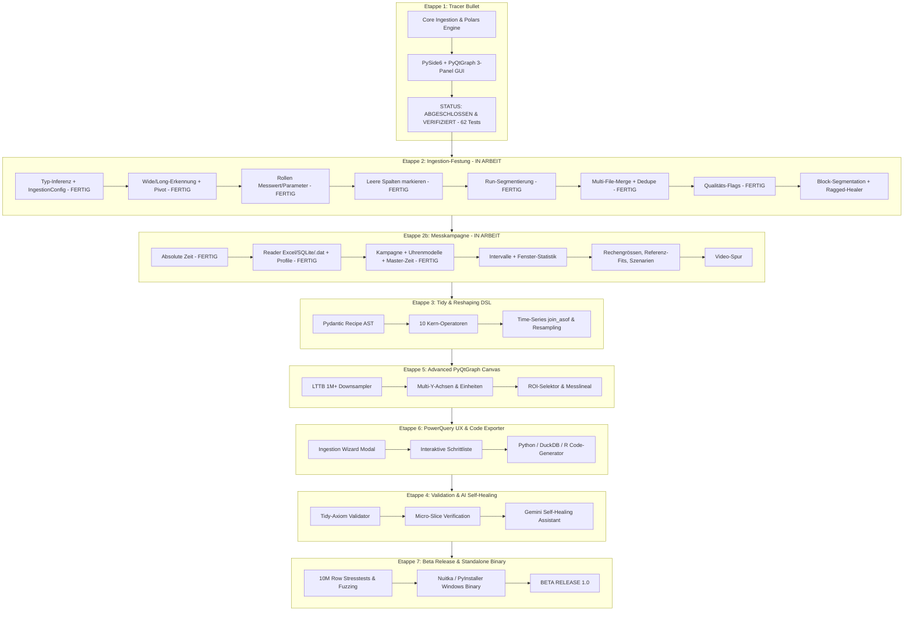

# Datualizer: Master-Etappen-Plan (Vom Fundament bis zum Beta Release 2026)

> **Dokument-Status:** Verbindliche Architektur- und Meilenstein-Referenz für alle beteiligten Entwickler und spezialisierten Agenten.  
> **Projekt:** Datualizer – High-Performance Tidy Data Wrangling & Visualization Framework für Sensor- und Messdaten.  
> **Technologie-Stack:** Python 3.11+, Polars, Apache Arrow, PySide6 (Qt 6), PyQtGraph, Pydantic v2, pytest.

---

## Architektur-Übersicht & Leitprinzipien

1. **Realdaten-Priorität (Robustness First):**
   Reale Messdaten (Prüfstände, Datenlogger, Sensoren, chemische Konzentrationsmessungen) sind fast nie saubere Rechtecke. Ingestion muss resilient gegenüber Multi-Row-Headern, Metadaten-Blöcken, Footer-Statistiken, Logging-Abbrüchen (ragged rows) und Sensor-Fehlercodes (`ERR*`, `--`, `-9999`) sein.
2. **Dual-Mode Datenhaltung (Wide vs. Long):**
   - **Wide-Format (Primary Engine Mode):** 1 Zeile = 1 Zeitstempel, Sensoren nebeneinander in Spalten. Essenziell für mathematische Modelle ($z = f(x, y)$), Korrelationen, Speichereffizienz und latenzfreies Zero-Copy-Plotting in PyQtGraph.
   - **Long-Format (Tidy Analysis Mode):** On-Demand Schmelzen (`to_long()` / `unpivot`) in `[timestamp, variable, value]` für Faceting, Gruppierungen und Tidyverse-Analysen.
3. **Deklarative Reproduzierbarkeit (JSON-AST Recipe):**
   Keine in-place destruktiven Datenoperationen. Jede Transformation ist ein serialisierbarer AST-Knoten (Undo/Redo, Snapshot-Navigation, Code-Export nach Python/Polars, SQL und R).
4. **Hardware-beschleunigte Visualisierung (60 FPS Native):**
   Hardware-Rendering über Qt Graphics View / OpenGL via PyQtGraph mit synchronisierten X-Achsen und LTTB-Downsampling. Keine Browser-Overheads oder Chromium-IPC-Latenzen.

---

---

## Meilensteine im Detail

### ✅ Etappe 1: Minimal End-to-End Tracer Bullet (ABGESCHLOSSEN)
*Status: 100% implementiert und verifiziert (62 von 62 Tests grün)*
- **Core Engine:**
  - `PreScanner`: Erkennung von Trennzeichen (`,`, `;`, `\t`), deutschem Dezimalkomma (`24,109`), Tausendertrennzeichen, UTF-8 BOM, Spalte-0-Header-Lücken und leeren Footer-Zeilen (Zeile 4933).
  - `CSVLoader`: Polars-Ladeengine, Konvertierung von Zeitstempeln (`HH:MM:SS`, ISO, Deutsch) in relative Sekunden (`time_seconds`), non-strict Float-Casting mit `AuditLog`.
  - `DualModeDataset`: Zero-Copy NumPy-Views (`to_numpy(col, allow_copy=False)`) für PyQtGraph, on-demand Tidy `to_long()`.
  - Operatoren: `clean_names` (Umlaut-Transliteration, Kanalkennungs-Erhalt), `drop_footer`, `unpivot`.
- **Desktop GUI (PySide6 + PyQtGraph):**
  - Virtuelles `PolarsTableModel` für ruckelfreies Scrollen ohne Speicherduplikation.
  - `MultiChannelPlotCanvas` mit verlinkten X-Achsen (`setXLink`), dynamischem Ein-/Ausblenden und synchronisiertem Fadenkreuz (Crosshair) mit Live-Multikanal-Wertanzeige.
  - `InspectorPanel` mit Metadaten, Kanalliste und Error-Audit-Badge.
  - `RecipePanel` mit Modus-Umschaltung ("Wide View" vs. "Tidy Melt").
  - `DatualizerMainWindow` mit integriertem 3-Panel Docking-Layout.
  - Getestet auf `SA_testmessung_1.csv` (4.931 Datenzeilen, 8 Kanäle).

---

### 🧱 Etappe 2: Die Ingestion-Festung für chaotische Realdaten (IN ARBEIT)
*Ziel: Kein Messgeräte-Export bringt Datualizer zum Absturz oder verfälscht still die Daten.*

> **Umpriorisiert (2026-10-04)** auf Basis echter Pipeline-Exporte, siehe [`DATENKATALOG_RUNS_EXPORT.md`](DATENKATALOG_RUNS_EXPORT.md).
> Die Probleme realer Daten lagen bei **Semantik und Qualität** (Typen, Rollen, Duplikate, Plausibilität), nicht in der Dateistruktur.
> Leitprinzip: **Automatik schlägt vor, Nutzer entscheidet.** Jede Heuristik ist über `IngestionConfig` überschreibbar, jede Entscheidung steht replaybar in `ingestion_spec`.

1. ✅ **Typ-Inferenz pro Spalte:** NUMERIC / IDENTIFIER / CATEGORICAL; nur numerische Kanäle werden gecastet, auditiert und geplottet (P4, P5).
2. ✅ **`IngestionConfig`:** Vokabulare, Schwellen, Spalten-Overrides, Long-Format-Rollen; aufgelöste, replaybare `ingestion_spec`.
3. ✅ **Wide/Long-Erkennung + Pivot:** Erkennung über Header und Datenform statt Dateiname; Kanal-Attribute (`unit` …) in `channel_attrs` (P1, P19).
4. ✅ **Rollen Messwert vs. Parameter** (P7): `ColumnKind.PARAMETER` für numerische Spalten, die in jedem Run konstant sind; Runs und Erkennung über `RoleConfig`, Overrides über `column_kinds`.
   ✅ **Leere Spalten markieren** (P9, P19): `fill_ratio` und `empty_columns`, markiert statt gelöscht; leere Kanäle werden nicht geplottet. ✅ Spalten ohne Einheit: `unitless_columns`.
5. ✅ **Run-Segmentierung:** `ds.runs` (Samples, Dauer, Median-Δt, Parameter, `aborted`), `channel_availability`, `run_time()`, `select_run()`; Run-Tabelle und Run-Filter im Inspector (P10, P11, P18).
6. ✅ **Multi-File-Merge mit Dedupe:** `load_csvs()`, SHA-256 pro Quelle (`ds.sources`), Duplikate übersprungen und auditiert, überlappende Snapshots über den Schlüssel dedupliziert (spätere Datei gewinnt, Konflikte ins Audit), `MergeConfig` (P2, P3). GUI: Mehrfachauswahl und „Add CSV (merge)“.
7. ✅ **Qualitäts-Flags:** `ds.quality_flags` (Ereignistabelle), `flag_mask()`, `with_flag_columns()`; `gap`, `missing`/`missing_calculated`, `stuck`, `jump`, `dropout`, `out_of_range`; Schwellen in `QualityConfig`, vorgeschlagene Sprungschwellen in der Spec; Plot ohne Linien über Lücken, Flag-Tabelle im Inspector (P12–P17).
8. ✅ **Einheiten aus Headern** (P20): `ds.units` aus Header-Mustern, Long-Attribut oder `UnitConfig`; Einheit aus dem Namen gelöst statt verworfen; Achsenbeschriftung mit Einheit.
9. ⏳ **Block-Segmentation** (Metadaten-Kopf, Multi-Row-Header, Footer-Statistiken) und **Ragged-CSV-Healer**, sobald Gerätedaten mit Kopfblöcken vorliegen.
10. ⏳ **Encoding-Matrix** (UTF-16, CP1252) sowie Spektren- und Matrix-Exporte.

---

### 🧭 Etappe 2b: Messkampagne – mehrere Quellen, eine Zeitachse (IN ARBEIT)
*Ziel: Alle Geräte einer Messkampagne (Datenlogger, Analysegeräte, OCR-Pipeline, Labjournal, Videos) auf einer gemeinsamen absoluten Zeitachse darstellen und die statistischen Annahmen der Auswertung sichtbar und umschaltbar machen.*

> **Eingeschoben (2026-10-13)** nach der Auswertung einer echten Messkampagne (SA, Ethanol-Oxidation, 12.10.2026): Jede Quelle hatte eine eigene Uhr (Versatz 16 min, nur relative Zeit, UTC/Lokalzeit gemischt, Videos ohne Frame-Zeitstempel), eigene Lücken und eigene Formate (`.dat`, `.xls`, `.xlsx`, SQLite). Die Kennwerte hingen an Annahmen (Uhrenversatz, Gerät-Skalierung, Response-Faktor, Blindwert, Fensterwahl).
> Sie zieht `join_asof` aus Etappe 3 sowie Mehrachsen-Plot und ROI aus Etappe 5 vor. Etappe 4 rückt hinter Etappe 6.
> Fachlogik bleibt generisch: Datualizer liefert Bausteine, die konkrete Auswertung ist eine JSON-Kampagnendatei (Prinzip 1).

1. ✅ **Absolute Zeit:** `TimeConfig` (Format, Zeitzone, Ursprung, Datumsformate), `time_origin`, `time_abs`, DST-sichere Sekunden, replaybar.
2. ✅ **Reader + Profile:** `load_source`; Excel (`.xlsx`, `.xls` inkl. Metadaten-Blätter), SQLite (ganze `.db` oder Abfrage, fehlende IDs), `.dat`; sechs Profile als JSON; Realdaten-Ausschnitte in `tests/fixtures/sa_12_10/`, Probleme in [`DATENKATALOG_SA_KAMPAGNE.md`](DATENKATALOG_SA_KAMPAGNE.md). Offen: Zeitzone pro Spalte.
3. ✅ **Kampagne + Uhrenmodelle:** `Campaign` (`campaign.json`), `ClockModel` (Versatz, Drift, Anker), Master-Zeit; Kampagnenfenster mit eigenem x-Array pro Spur und Datumsachse, Quellen-Dock mit Uhren-Editor. Nachtrag: Mehrblatt-Excel und SQLite mit mehreren Tabellen fragen beim Öffnen nach Blatt bzw. Tabelle und dem Datum für Uhrzeiten (`ReaderError.choice/options`, `with_choices`); die Wahl replayt über `campaign.json`.
4. ✅ **Abdeckungsansicht:** `session.coverage()` (Spanne, Abschnitte mit Werten, Lücken als `time_gap` oder `no_values`), Abdeckungsspur über den Subplots im Kampagnenfenster, einschaltbar unter *Settings → Tools → Coverage Info* (eine Zeile pro Quelle, Lücken schraffiert, x-verlinkt, Lücke in der Infozeile).
   - **Einstellungen des Kampagnenfensters** (eingeschoben nach einem Blick auf die echten SA-Daten, ein PR pro Punkt oder kleiner Gruppe). Zwei Ebenen: Was pro Kanal oder Quelle gilt, steht in `campaign.json`; persönliche Vorlieben stehen in QSettings (`datualizer_gui/settings.py`). Alles betrifft nur die Darstellung.
     1. ✅ Darstellung pro Kanal: Linie, Punkte, Treppe, Linie + Punkte (`ChannelDisplay.style`, Standard aus `SourceProfile.plot_style`, Labjournal = Treppe).
     2. ✅ Y-Skalierung pro Kanal: Auto, robust (Perzentile), fest; Werte ausserhalb am Rand markiert (`YScale`, `OutOfRangeMarkers`).
     3. ✅ Anzeigename pro Kanal (`ChannelDisplay.alias`) für Achse, Baum und Infozeile.
     4. ✅ Zoom: Mausrad nur auf der Zeitachse (über einer Y-Achse zoomt es diese), Y passt sich dem sichtbaren Ausschnitt an (`TimeViewBox`, beides abschaltbar).
     5. ✅ Kanäle gruppieren (ein Subplot pro Kanal, nach Einheit, nach Quelle) mit Legende; Farben nach Kanal, nach Quelle (wie die Abdeckungsspur) oder manuell (`ChannelDisplay.color`). Y-Bereich einer Gruppe: Vereinigung der festen bzw. robusten Bereiche, sonst auto.
     6. ✅ Werte unter dem Mauszeiger als Leiste, Tooltip am Mauszeiger oder Tabelle im Dock *Values* (alles sichtbar, nichts abgeschnitten); Nachkommastellen fest oder automatisch (4 signifikante Stellen).
     7. ✅ Zeit: Zone der Kampagne wählbar (`session.set_timezone`), Achse automatisch, als Uhrzeit, Datum + Uhrzeit oder t − t0 (`Campaign.time_reference` in `campaign.json`); Mindesthöhe der Subplots, darunter scrollt die Ansicht und jeder Subplot zeigt seine Zeitachse.
     8. ✅ Export als PNG, SVG, PDF für den Bericht (*Campaign → Export Plot…*): helles Theme, Breite/Höhe in mm, Schrift in pt, Linienbreite in pt, dpi für PNG; zeigt den Ausschnitt und die Y-Bereiche wie am Bildschirm. SVG und PDF bleiben Vektor.
     - Später mit Schritt 5/6: Qualitäts-Flags als Marker, Lücken-Schwelle, Standardauswahl der Kanäle.
5. ✅ **Messschritte (Intervalle):** `IntervalMapping` (Spaltenrollen als Konfiguration, Vorschlag aus dem Profil oder der Datenform, Zeiten auf der Uhr einer anderen Quelle möglich), manuelle Schritte per Rechtsklick „Marker ○ ○“, `WindowRule` (Teilfenster), Bänder über allen Plots (einschaltbar unter *Settings → Tools → Interval Bands*, ein Zeichenobjekt pro Plot), Steps-Dock mit Zuordnungsdialog und Problemliste; alles in `campaign.json`.
6. ✅ **Fenster-Statistik + Fenster-Inspektor** (Steigung mit Standardfehler, 2-Punkt, Drift, Integral; Dock „Window“ mit Fits, Kennwerten, Ampel, Tastatur und Fenster-Override pro Schritt in `campaign.json`); Recherche und Arbeitspakete A–D: [`RESEARCH_FENSTER_STATISTIK.md`](RESEARCH_FENSTER_STATISTIK.md). ✅ zweiseitiges `spike`-Flag (Hampel, P31, Paket C): `QualityConfig.spike_window_s`, `spike_k`, `spike_channels`, `spike_min_scale`, `ds.quality_notes`. ✅ Kern-Statistik (Paket A): `datualizer_core/stats/window.py` mit `StatsConfig` (in `campaign.json`), `WindowSpec`, `WindowResult`, `window_stats` (n, Ausschlüsse, Abdeckung, Lage/Streuung, OLS-Steigung mit klassischem SE, 2-Punkt mit GUM-Unsicherheit inkl. Uhrenunsicherheit, Integral ohne Überbrückung von Lücken, `checks`/`assumptions`) und `session.window_table(kanäle)`. ✅ Unsicherheit und Autokorrelation (Paket B): `n_eff`/`sem_eff`, `slope_se_hac` (Newey-West), `slope_se_ar1`, `durbin_watson`, `slope_theil_sen` mit `slope_ts_ci`, `integral_u`, Stationaritäts-Ampel `stationary` mit `halves_diff` und Begründung in `checks`. Offen: Paket D (Fenster-Inspektor), R-Statistik (optional).
7. ✅ **Abgleich-Werkzeuge** (PR 9 im [Plan Auswertung](PLAN_AUSWERTUNG_KAMPAGNE.md)): Versatz aus Uhrenpaaren in Zellen einer Arbeitsmappe (`ClockCells`, `CellPair`, `session.clock_from_cells`: Median der Paar-Versätze, Streuung als Unsicherheit, Konfiguration im `ClockModel` für Replay), Kreuzkorrelation zweier Spuren auf gemeinsamem Raster mit begrenztem Suchbereich (`session.cross_correlate` → `XCorrResult` mit Versatz, Kurve r(Versatz), Ampel), Dialog *Align Clock…* im Quellen-Dock (Überlagerung, Schieber, Korrelationskurve, Anker-Liste, „Apply“ mit `method` und `note`).
8. ⏳ **Rechengrössen, Referenz-Fits, Szenarien:** sicherer Formel-Parser, Kalibrier- und XY-Ergebnisansicht, Fenstertabelle mit Export. Ausgearbeitet in [`PLAN_AUSWERTUNG_KAMPAGNE.md`](PLAN_AUSWERTUNG_KAMPAGNE.md) (PR 1–8, mit Schritt 7 als PR 9 ✅ und Schritt 10 als PR 10); Übergabeprompts in [`UEBERGABE_AUSWERTUNG.md`](UEBERGABE_AUSWERTUNG.md).
   - PR 1 ✅ Formelkern `datualizer_core/calc/`: `compile_expr` (Python-`ast` mit Positivliste, kein `eval`, `ExprError` mit Spalte und bekannten Namen), `Expr.to_polars()` und `Expr.evaluate()` mit derselben Bedeutung, `UArray` (Dual-Zahlen: `budget`, `u`, `u_random`, `u_syst`, voll korrelierte syst. Gruppen), `Constant`.
   - PR 3 ✅ Text in Formeln (nur `==`/`!=`, fehlender Text weder gleich noch ungleich, Polars = numpy), Tippfehler-Vorschlag mit gleichem Anfangsbuchstaben; `datualizer_core/campaign/evaluation.py`: `StepClass` (Formel über Schrittparameter, Hinweis bei keinem oder mehreren Treffern), `NamedWindow` (`window_rule` bleibt Fenster `default`, Override pro Fenster), `Measure` und `session.step_table()` mit Wert, Standardunsicherheit und Befunden je Messgrösse; praktische Stationarität per TOST (`StatsConfig.equivalence`, `stationary_practical`); Klassen-Spalte im Steps-Dock, Fensterauswahl im Window-Dock.
   - PR 2 ✅ Rechenkanäle (`DerivedChannel` mit `pieces` nach Master-Zeit), Masken (`Mask`, Flag `masked` im Datensatz und Ausschluss in Statistik, Schraffur im Kampagnenplot), Testa-iFID `Settings*.xml`-Reader (`sens`, `zero`), `suggest_linear_calibration`, `SqliteOptions.json_columns`.
9. ⏳ **Video-Spur:** Frame-Ansicht synchron zur Kampagnenuhr, Anker aus im Bild abgelesener Uhrzeit.
10. ⏳ **Beispielkampagne + Doku:** End-to-End-Abgleich mit der bestehenden Skript-Auswertung.

---

### 🔄 Etappe 3: Die vollständige Tidy- & Reshaping-DSL-Engine (JSON-AST)
*Ziel: Ein lückenloser, mathematisch sauberer 10-Operatoren-Katalog.*
1. **Pydantic Recipe AST:**
   - Serialisierbares JSON-Schema (`recipe.json`) mit strikter Parameter-Validierung.
   - Idempotente Ausführung, Snapshot-State, Undo/Redo und Replay-Fähigkeit.
2. **Die 10 Kern-Operatoren:**
   - `crop_table(start_row, end_row, start_col, end_col)`: Zuschneiden beliebiger rechteckiger Bereiche.
   - `collapse_headers(rows, sep, clean)`: Mehrzeilige Header hierarchisch verschmelzen (`[Sensor 1, °C]` $\rightarrow$ `sensor_1_degc`).
   - `pivot_longer(id_vars, value_vars, names_to, values_to)`: Unpivot in Tidy-Long-Format.
   - `pivot_wider(id_cols, names_from, values_from, agg_fn)`: Pivotieren in Wide-Format mit Kollisionsauflösung.
   - `split_column(col, pattern, into, remove)`: Regex-Extraktion zusammengesetzter Attribute.
   - `normalize_entities(entity_name, key_cols, attr_cols)`: 3NF-Splitting redundanter Dimensionen in verknüpfte Tabellen.
   - `clean_names()`: Bereinigung von Bezeichnern.
   - `fill_missing(cols, strategy)`: Forward-Fill (LOCF) / Backward-Fill für langsam getaktete Statussignale.
   - `filter_rows(predicate)`: Filtern nach Schwellwerten, Rauschausschluss, Einschwingphasen.
   - `math_transform(col, expr, new_col)`: Kalibrierkurven ($y = m \cdot x + b$) und physikalische Umrechnungen.
3. **Zeitreihen-Ausrichtung (`join_asof` & Resampling):**
   - Zusammenführen von Sensoren mit asynchronen Taktraten (z. B. 100 Hz Temperatur + 1 Hz Druck + Event-Trigger) über konfigurierbare Zeittoleranzen ($\Delta t$).

---

### 🛡️ Etappe 4: Tidy-Axiom-Validation & AI Self-Healing Loop (nach Etappe 6 verschoben)
*Ziel: Automatische Fehlererkennung und KI-gestützte Reparatur fehlerhafter Daten.*
1. **Micro-Slice & Axiom-Checker:**
   - Validierung jedes Transformationsschritts zuerst auf einer 50-Zeilen-Mikrokopie, anschließend auf der Gesamttabelle.
   - Axiom-Prüfungen:
     - Keine Messwerte in Headern.
     - Eindeutigkeit der Primärschlüssel nach `pivot_wider`.
     - Atomarität der Zellenwerte.
     - Typen-Homogenität nach Reshaping.
2. **LLM Self-Healing Assistant (Gemini API):**
   - Kompakter Token-Payload: Erste 15 Zeilen, erkannte Datentypen, Fehler-Traceback.
   - Strikte JSON-Ausgabe: Gemini generiert Pydantic-validierte JSON-Aktionsketten (kein unkontrollierter Freitext).
   - Automatischer Feedback-Loop: Wenn ein Pivot zu Schlüsselkollisionen führt, repariert Gemini das Recipe automatisch mit der passenden Aggregationslogik.

---

### 📈 Etappe 5: High-Performance Visualisierungs-Suite (PyQtGraph Advanced)
*Ziel: Ruckelfreies 60-FPS-Erlebnis bei mehr als 1 Million Messpunkten.*
1. **LTTB (Largest-Triangle-Three-Buckets) Downsampling:**
   - Intelligente Reduktion von $10^6$ Datenpunkten auf $2.000$ Pixelpunkte unter exakter Bewahrung aller Minima, Maxima und Peaks.
   - Vorgezogen (2026-10-13) als Zwischenstufe: Peak-Downsampling (ein Min/Max-Paar pro Bildschirmspalte) und Clip-to-View von pyqtgraph in beiden Plot-Ansichten (`datualizer_gui/components/curves.py`), Kurven und Achsen als Pixmap-Cache, Mausbewegungen auf 60 Hz begrenzt, in der Kampagne bleiben unveränderte Subplots beim Ankreuzen erhalten. Gemessen offscreen mit Software-Rendering, 1 Mio. Zeilen × 4 Kanäle: Fadenkreuz 5 ms statt mehrerer Sekunden pro Bild, Verschieben ≈ 160 ms. LTTB und Messung auf echter Hardware bleiben offen.
   - Nachgebessert (2026-10-13) mit dem PicoLog-Export (36 000 Zeilen × 8 Kanäle) als Massstab: eigenes Peak-Downsampling (`FastCurve`), das nie über Lücken verbindet (pyqtgraphs Downsampling überbrückte den 78-min-Aussetzer mit einer Linie), 1-px-Stifte statt 1,5 px, Gitter nur an beschrifteten Ticks, Pixmap-Cache passend zur Bildschirmgrösse. Gemessen offscreen bei 8 Kanälen: Verschieben 461 → 47 ms, Hover 390 → 10 ms pro Bild.
2. **Multi-Y-Achsen & Einheiten-Gruppierung:**
   - Automatische Gruppierung von Kanälen nach physikalischer Einheit (z. B. Subplot A: Alle Temperaturen in °C; Subplot B: Alle Drücke in bar).
   - Unterstützung für primäre und sekundäre Y-Achsen (Left/Right Y-Axis).
3. **Interaktive Analysetools:**
   - ROI (Region of Interest) Selektor für Zeitfenster-Ausschnitte.
   - Differenz-Messlineal ($\Delta t$, $\Delta y$, Steigung $dy/dt$).
   - Synchronisierte Hüllkurven (Min/Max-Bänder und gleitender Mittelwert).

---

### 🖥️ Etappe 6: Vollständige Desktop-UX & Code Exporter (PowerQuery-Ergonomie)
*Ziel: Mächtig wie PowerQuery, intuitiv wie Excel.*
1. **Interaktiver Ingestion-Wizard:**
   - Modal-Dialog mit Rohdaten-Preview, automatischer Block-Erkennung und manueller Korrekturmöglichkeit per Klick (Header-Zeile wählen, Delimiter überschreiben).
2. **Visueller Recipe-Editor (Schrittliste):**
   - Drag & Drop zum Umsortieren von Transformationsschritten.
   - Schrittweises Anklicken zeigt den Zustand der Daten nach dem jeweiligen Schritt (Time-Travel Debugging).
3. **Multi-Target Code-Generator:**
   - **Python / Polars:** Exportiert das vollständige Recipe als autarkes Python-Skript.
   - **DuckDB SQL:** Exportiert Reshaping- und Transformationsabfragen als performantes SQL.
   - **R Tidyverse:** Exportiert den Workflow als R-Skript (`library(tidyr)`, `library(dplyr)`).
   - **Datenexport:** Export nach Parquet, Feather/Arrow IPC oder sauberem Tidy-CSV.

---

### 🚀 Etappe 7: Beta Release Härtung, Benchmarks & Standalone-Packaging
*Ziel: Ein schlüsselfertiges Produkt für Test- und Produktionsumgebungen.*
1. **Stresstests & Fuzzing:**
   - Benchmarking auf 10 Millionen Zeilen (Speicherverbrauch, Ladezeiten, FPS).
   - Fuzzing mit synthetisch korrumpierten CSV/TXT-Dateien.
2. **Standalone Windows Binary:**
   - Paketierung als portable Windows `.exe` / Installer via Nuitka oder PyInstaller (keine Python-Installation auf dem Zielrechner erforderlich).
3. **Dokumentation & Release:**
   - Ausführliches Benutzerhandbuch mit Screenshots.
   - Beispieldatensätze (`SA_testmessung_1.csv`, Konzentrationsmessungen, Prüfstandsexporte).
   - GitHub/GitLab CI Pipeline für automatisierte Builds.

---

## Richtlinien für spezialisierte Agenten

> Verbindliche, aktuelle Agenten-Regeln stehen in [`AGENTS.md`](../AGENTS.md). Die folgenden Punkte sind ein Auszug.

- **Schnittstellen-Verträge beachten:** Jede Datenübergabe zwischen Ingestion, Pipeline und GUI nutzt `DualModeDataset` bzw. das Pydantic `RecipeAST`.
- **Zero-Copy vorziehen:** Für PyQtGraph immer NumPy/Arrow-Views ohne Speicherduplikation verwenden (`df[col].to_numpy()`).
- **Nicht-destruktiv arbeiten:** Keine In-Place-Mutationen von DataFrames; jede Operation erzeugt einen neuen Pipeline-Schritt.
- **Automatisierte Verifikation:** Vor jedem Meilenstein-Abschluss müssen alle Unit- und Integrationstests (`pytest -v`) nachweisbar grün durchlaufen.
